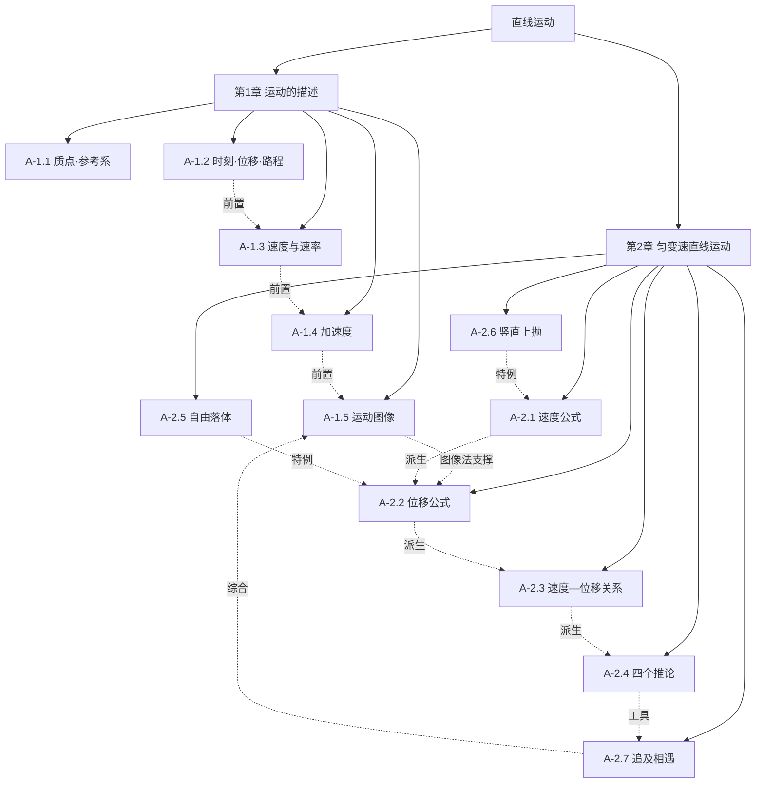

# 01 力学 · 样章：直线运动

> **状态**：【样章待验收】【章号待核对】
> **覆盖**：第1章 运动的描述（5 考点）+ 第2章 匀变速直线运动（7 考点）= 12 考点 / 12 母题
> **适用**：上海高中物理 必修第一册；Ⅰ 级为合格考要求，Ⅱ 级为等级考要求
> **本章定位**：整章只有一条主线——"用 a 描述速度怎么变，再用 a 把位置算出来"。所有公式都是这条主线的推论，不要当成 7 个孤立公式背。

## 本单元知识图谱

---

# 第1章 运动的描述

## A-1.1 质点、参考系与坐标系

*力学 › 必修一 第1章 运动的描述 ｜ Ⅰ · 考频低 ｜ 前置：无 ｜ 关联：A-1.2*

**原理与公式**

- **质点**：用来代替物体的、有质量的点，是一种理想化模型。物体能否看成质点，取决于**研究的问题**，不取决于物体大小。
- **参考系**：描述物体运动时选作参照的另一物体。同一运动，选不同参考系描述结果可以不同（如"电梯里的人看地面上升"）；不特别说明时以地面为参考系。
- **坐标系**：把位置定量化。一维直线运动取一条坐标轴，记位置 x，则位移 Δx = x₂ − x₁。

**适用条件**

- 质点：物体各部分运动状态相同，或物体的线度远小于所研究的空间尺度。地球公转可视为质点，地球自转不能。
- 参考系：一旦选定，描述同一过程时不得中途更换，否则位移、速度会失去可比性。

**易错边界**

1. "质点就是很小的物体"——错。原子在研究内部结构时不能视为质点，火车在研究全程运行时间时可以。
2. "参考系必须静止"——错。参考系可以任意选，包括运动的物体（如以车厢为参考系研究乘客）。
3. 判断"是否运动"时忘记先声明参考系，导致同一现象两种答案都对。

**命题角度**

上海卷极少单独考质点，通常作为选择题的一个选项，或藏在"下列说法正确的是"里，与位移、速度概念混在一起考。

**母题 M-1.1**（教材改编）

下列情况中，能把加点物体看成质点的是（　）
A. 研究地球的自转　B. 研究地球绕太阳的公转
C. 研究火车通过某一路标所用的时间　D. 研究乒乓球在空中的旋转

**解析**

1. 判据只有一条：物体的大小、形状对所研究的问题是否可忽略。
2. A：自转研究的正是地球各部分的转动差异，大小形状不可忽略 → 不能。
3. B：地球直径 1.28×10⁴ km，公转轨道半径 1.5×10⁸ km，相差 4 个数量级，各点运动几乎相同 → 可以。
4. C：火车长度与"路标"尺度相当，"通过"的时间由车长决定，车长不可忽略 → 不能。
5. D：旋转本身就是各部分绕轴的运动 → 不能。
答案：**B**

**错解陷阱**：选 A 或 C 的同学用的是"地球很大所以不能 / 火车很长所以不能"的大小判据；选 D 的同学凭"乒乓球很小所以能"的直觉。判据是**问题**，不是**物体**。

**变式**

① 研究"神舟飞船与空间站交会对接的过程"时，飞船能否视为质点？研究它绕地飞行的周期时呢？（提示：前者涉及相对姿态与位置，后者可以）
② 诗句"两岸青山相对出，孤帆一片日边来"中，"青山相对出"是以什么为参考系？

---

## A-1.2 时刻与时间、位移与路程

*力学 › 必修一 第1章 运动的描述 ｜ Ⅰ · 考频低 ｜ 前置：A-1.1 ｜ 关联：A-1.3*

**原理与公式**

- **时刻**：时间轴上的一个点，对应位置或状态（"第 3 s 末""t = 2 s"）。
- **时间（间隔）**：时间轴上的一段，对应一个过程（"前 3 s 内""第 3 s 内"）。第 n s 内 = 从 (n−1) s 末到 n s 末。
- **位移**：从初位置指向末位置的有向线段，矢量，大小只由始末位置决定。
- **路程**：运动轨迹的实际长度，标量，与路径有关。
- 恒有 |位移| ≤ 路程；**只有单向直线运动**时取等号。

**适用条件**

- 位移与路径无关，可用来处理"绕行后回到原点"这类问题；路程必须沿轨迹积分，不能只看始末位置。

**易错边界**

1. "第 3 s 内"是 1 s 的时间，不是"第 3 秒末"这一刻。
2. 曲线运动中位移大小一定小于路程；直线运动若往返（如竖直上抛），也小于。
3. 求平均速度用位移，求平均速率用路程，两者混用是最常见的整题失分点（见 A-1.3）。

**命题角度**

以体育、交通情境命题（跑道、地铁线路、导航里程），一问位移一问路程；或与平均速度、平均速率合并成一题。

**母题 M-1.2**（原创）

标准田径场跑道周长 400 m，可视为半径 R 的圆。运动员从 A 点出发：
(1) 沿跑道跑一整圈，位移大小和路程各是多少？
(2) 跑半圈到达直径另一端 B，位移大小和路程各是多少？（π 取 3.14）

**解析**

1. 圆周长 400 m ⇒ R = 400/(2π) = 400/6.28 ≈ 63.7 m，直径 d = 127.4 m。
2. (1) 跑一圈回到 A 点：初末位置重合 ⇒ 位移 **0**；路程 = 轨迹长 = **400 m**。
3. (2) 跑半圈：初末位置是直径两端 ⇒ 位移大小 = d ≈ **1.3×10² m**（127 m），方向由 A 指向 B；路程 = 半圈 = **200 m**。

**错解陷阱**：把"跑了 400 m"当成位移 400 m。位移只看起点和终点，跑得越远不代表位移越大；绕地球一圈位移为 0。

**变式**

① 跑 3/4 圈，位移大小是多少？（√2·R ≈ 90 m，路程 300 m）
② 若运动员先跑半圈再原路返回 A 点，全程位移和路程各是多少？（0，400 m）

---

## A-1.3 速度、平均速度与瞬时速度

*力学 › 必修一 第1章 运动的描述 ｜ Ⅱ · 考频高 ｜ 前置：A-1.2 ｜ 关联：A-1.5、A-2.2*

**原理与公式**

- **平均速度**：v̄ = Δx/Δt，矢量，方向与位移方向相同。它只反映整段的**粗略快慢**，不反映中间细节。
- **瞬时速度**：Δt → 0 时平均速度的极限值，矢量，方向沿轨迹切线。
- **平均速率**：路程/时间，标量，一般 ≠ 平均速度的大小（曲线或往返运动时）。
- **瞬时速率** = 瞬时速度的大小。
- 匀变速直线运动中：v̄ = (v₀ + v)/2（仅匀变速可用）。

**适用条件**

- v̄ = Δx/Δt 对任何运动都成立，但**只对匀变速**才等于 (v₀+v)/2。
- 对变速运动，全程平均速度一般**不等于**各段速度的算术平均（时间等分除外）。

**符号与单位**：v̄、v [m/s]；Δx [m]；Δt [s]；1 m/s = 3.6 km/h。

**易错边界**

1. 平均速度 ≠ 平均速率：绕场一周平均速度为 0，平均速率不为 0。
2. 平均速度 ≠ (v₁+v₂)/2：只有**时间等分**时才能用算术平均；**位移等分**要用调和平均。
3. "汽车速度表读数"是瞬时速率，不是平均速度。

**命题角度**

上海卷常考"时间等分"与"位移等分"两种平均速度的对比，或结合 v-t 图像判断某段时间的平均速度与中间时刻速度的关系。

**母题 M-1.3**（真题改编）

甲、乙两物体沿同一直线运动，全程位移相同。
甲：前一半**时间**速度 v₁ = 10 m/s，后一半时间 v₂ = 20 m/s；
乙：前一半**位移**速度 v₁ = 10 m/s，后一半位移 v₂ = 20 m/s。
求甲、乙全程的平均速度。

**解析**

1. 设全程总时间为 2t、总位移为 2x。
2. **甲（时间等分）**：前半程位移 10t，后半程 20t，总位移 30t，总时间 2t
   ⇒ v̄甲 = 30t/2t = **15 m/s**（正是算术平均，因为时间等分）。
3. **乙（位移等分）**：前一半用时 x/10，后一半用时 x/20，总时间 x/10 + x/20 = 3x/20，总位移 2x
   ⇒ v̄乙 = 2x ÷ (3x/20) = 40/3 ≈ **13.3 m/s**。
4. 通用式：v̄乙 = 2v₁v₂/(v₁+v₂) = 2×10×20/30 = 13.3 m/s，恒小于算术平均。

**错解陷阱**：两人都答 15 m/s。错因是把"平均速度"当成"速度的平均值"。平均速度是**总位移除以总时间**，必须回到定义；位移等分时，低速段占用的**时间更长**，所以平均值被拉低，13.3 < 15 是必然的。

**变式**

① 若 v₂ = 2v₁，证明 v̄乙 = 4v₁/3 < 1.5v₁，并说明差距随 v₂/v₁ 增大而增大。
② 甲、乙同时出发、全程位移相同，谁先到达？（甲先到，13.3 < 15）

---

## A-1.4 加速度

*力学 › 必修一 第1章 运动的描述 ｜ Ⅱ · 考频高 ｜ 前置：A-1.3 ｜ 关联：A-1.5、A-2.1*

**原理与公式**

- **定义**：a = Δv/Δt = (v − v₀)/t，矢量，方向与 Δv 相同（不是与 v 相同）。
- **物理意义**：速度变化的快慢，即"每秒速度改变多少 m/s"，单位 m/s²。
- **加速/减速判据**：a 与 v **同向** → 加速；a 与 v **反向** → 减速。与 a 正负无关，与 a 大小也无关。
- 一维代数运算：先规定正方向，与正方向同向的矢量取正，反向取负，再代入公式。

**适用条件**

- 定义式对任何运动成立；但只有当 a 恒定时，才能用 A-2.1 的 v = v₀ + at。

**易错边界**

1. "a 大则 v 大"——错。a 描述变化快慢，与速度大小无关；a 很大时 v 可以为零（上抛最高点 a = g）。
2. "a 减小则减速"——错。只要 a 与 v 同向，a 减小仍是加速，只是加速变慢。
3. 求加速度时忘记速度反向要变号，把 8 → −12 做成 12 − 8 = 4，结果差一个量级。

**命题角度**

以"足球被踢""汽车刹车""乒乓球被击打"等短时间速度突变情境命题，核心就一个：Δv 是**矢量差**，反向必须变号。或与 v-t 图斜率结合。

**母题 M-1.4**（真题改编）

足球以 8 m/s 的速度水平飞来，运动员一脚将其以 12 m/s 的速度沿相反方向踢出。若脚与球的作用时间为 0.2 s，求足球在这段时间内的平均加速度。

**解析**

1. 规定**原速度方向（飞来方向）为正方向**。
2. 初速度 v₀ = +8 m/s；末速度 v = −12 m/s（反向，取负）。
3. Δv = v − v₀ = −12 − 8 = −20 m/s。
4. a = Δv/Δt = −20/0.2 = **−100 m/s²**。
5. 负号表示加速度方向与原速度方向**相反**，即沿踢出方向；大小为 100 m/s²，约 10g。

**错解陷阱**：写成 a = (12 − 8)/0.2 = 20 m/s²。错因是只算了速度大小的变化，忽略了方向反转——Δv 是矢量差，反向时两速度要相减成 −20 而不是 4。这类题数值差 5 倍，且方向判断完全相反。

**变式**

① 若规定"踢出方向"为正方向，重新求 a。（+100 m/s²，结论不变）
② 若只问"速度变化量"，答多少？（−20 m/s，负号仍表示方向）
③ 同样的 0.2 s、100 m/s²，若球质量 0.4 kg，脚对球的平均作用力多大？（40 N，为牛顿第二定律埋伏笔）

---

## A-1.5 运动图像（x-t 图与 v-t 图）

*力学 › 必修一 第1章 运动的描述 ｜ Ⅱ · 考频高 ｜ 前置：A-1.3、A-1.4 ｜ 关联：A-2.2、A-2.7*

**原理与公式**

| 图像 | 斜率 | 面积 | 交点 | 纵截距 |
|---|---|---|---|---|
| x-t 图 | 速度 v（正负表方向） | 无意义 | 两物体**相遇** | 初位置 x₀ |
| v-t 图 | 加速度 a | **位移**（t 轴上方为正） | 两物体**速度相等** | 初速度 v₀ |

- 匀变速运动的 v-t 图是一条**直线**；x-t 图是**抛物线**（不是直线）。
- 图线拐点：加速度发生突变（如加速转匀速）。
- 图线与 t 轴围成的"负面积"表示反向位移，求总位移时代数和。

**适用条件**

- 图像只描述**一维**运动；v-t 图不能当轨迹看，也不能直接读出"物体在哪儿"（还缺初始位置）。

**易错边界**

1. 把 v-t 图当成运动轨迹（最常见）。
2. 认为 v-t 图两线交点表示"相遇"——只表示速度相等，此刻距离可能有极值（正是追及问题的临界点）。
3. 求面积时把 t 轴下方的三角形也当正数加，导致位移偏大。

**命题角度**

上海卷极爱考"图像转换"：给 x-t 图求 v-t 图、给 v-t 图求某时刻位置、判断两物体何时相距最远。也常与追及相遇合成一道大题。

**母题 M-1.5**（真题改编）

某质点沿直线运动的 v-t 图像如下：0～2 s 内速度由 0 均匀增大到 4 m/s；2～4 s 内保持 4 m/s；4～6 s 内均匀减小到 0。求：
(1) 各段的加速度；
(2) 0～6 s 内的总位移和平均速度；
(3) 若 t = 0 时质点位于 x = 0，t = 5 s 时它的位置。

**解析**

1. (1) 斜率即加速度：
   - 0～2 s：a₁ = (4−0)/2 = **2 m/s²**
   - 2～4 s：a₂ = **0**
   - 4～6 s：a₃ = (0−4)/2 = **−2 m/s²**（大小为 2，方向与运动方向相反）
2. (2) 面积即位移，分三块：
   - 0～2 s：½×2×4 = 4 m
   - 2～4 s：2×4 = 8 m
   - 4～6 s：½×2×4 = 4 m
   - 总位移 x = 4+8+4 = **16 m**，方向沿正方向。
   - 平均速度 v̄ = 16/6 ≈ **2.7 m/s**。
3. (3) 5 s 内的位移 = 4 + 8 + ½×(4+2)×1 = 4+8+3 = 15 m ⇒ 位置 x = **15 m**。
   （注意不能用 4 m/s × 5 s = 20 m，5 s 内不是匀速）

**错解陷阱**：第 (3) 问用"末速度 × 时间"或"平均速度 × 时间"却取错平均速度的人很多。v-t 图题的正解永远是**算面积**，或用分段公式；任何"全程匀速"的简化都会错。

**变式**

① 把上图改为 x-t 图（同样的三段形状），各段速度是多少？物体是否折返？（速度 2、4、0 m/s，不折返）
② 若另一物体从 t = 0 起以 3 m/s 匀速同向运动，两者何时相距最远？最远多少？（t = 2 s 时速度相等，相距 4 m）

---

# 第2章 匀变速直线运动

> 全章只有 3 个独立公式，其余都是推论：
> **v = v₀ + at**（不含 x）　**x = v₀t + ½at²**（不含 v）　**v² − v₀² = 2ax**（不含 t）
> 选公式的原则：**题目不缺哪个量，就用不含那个量的公式**。这一条能省掉一半的运算。

## A-2.1 匀变速直线运动的速度公式

*力学 › 必修一 第2章 匀变速直线运动 ｜ Ⅱ · 考频高 ｜ 前置：A-1.4 ｜ 关联：A-2.2*

**原理与公式**

- v = v₀ + at（速度—时间关系）
- 含义：速度随时间**均匀**变化，每经过 1 s 速度改变 a。
- 逆向使用：t = (v − v₀)/a，可求达到某速度所需时间。

**适用条件**

- a 恒定（大小、方向都不变）的直线运动。
- 刹车类问题必须先算**停止时间** t₀ = v₀/|a|，t > t₀ 后物体已静止，不能再代入公式。

**易错边界**

1. 刹车问题直接代 t：v₀ = 20 m/s、a = −4 m/s²、t = 6 s，公式给出 v = −4 m/s，物理上早已停止（t₀ = 5 s），正确答 0。
2. a 与 v 反向时忘记取负，导致结果偏大。
3. 多过程问题中把上一段的末速度当下一段的初速度却忘了换正方向。

**命题角度**

单独考很少，多作为多过程题的"第一问"；陷阱集中在刹车停止时间与反向运动。

**母题 M-2.1**（教材改编）

汽车以 10 m/s 的速度在平直公路上行驶。
(1) 若以 2 m/s² 的加速度匀加速，5 s 末速度多大？
(2) 从 10 m/s 加速到 30 m/s 需要多长时间？
(3) 若改为刹车，加速度大小为 4 m/s²，6 s 末速度多大？

**解析**

1. (1) v = v₀ + at = 10 + 2×5 = **20 m/s**。
2. (2) t = (v − v₀)/a = (30 − 10)/2 = **10 s**。
3. (3) 先判停止时间：t₀ = v₀/|a| = 10/4 = 2.5 s。
   6 s > 2.5 s ⇒ 汽车在 2.5 s 时已停止，之后保持静止
   ⇒ 6 s 末速度 = **0**。
   （若直接代入：v = 10 − 4×6 = −14 m/s，荒谬——车不会自己倒着开）

**错解陷阱**：第 (3) 问答 −14 m/s 或 14 m/s。错因是没做"停止判定"。**凡刹车、制动、减速到零的题，第一件事就是算 t₀**，这是整章最高频的失分点。

**变式**

① 第 (3) 问改为"5 s 内的位移"，结果是多少？（先判 t₀ = 2.5 s，x = v₀²/2a = 12.5 m）
② 若刹车加速度只有 2 m/s²，6 s 末速度？（t₀ = 5 s < 6 s，答 0；恰好是临界情形，可用于讲评）

---

## A-2.2 匀变速直线运动的位移公式

*力学 › 必修一 第2章 匀变速直线运动 ｜ Ⅱ · 考频高 ｜ 前置：A-2.1 ｜ 关联：A-1.5、A-2.4*

**原理与公式**

- x = v₀t + ½at²（位移—时间关系）
- 等价形式：x = (v₀ + v)t/2（平均速度法，**只对匀变速**成立）
- 由 v-t 图看：位移 = 梯形面积 = (v₀+v)t/2，展开即得上式。
- 求末速度不含、求时间不含时，优先用 v² − v₀² = 2ax（见 A-2.3）。

**适用条件**

- a 恒定；x 是**位移**不是路程，往返运动需分段或注意正负。
- 平均速度法 x = (v₀+v)t/2 只能用于匀变速，变速运动禁用。

**易错边界**

1. 把 x 当路程：竖直上抛回落时位移小于路程。
2. 多过程题中全程套一个公式（加速度变了必须分段）。
3. 初速度为零时误写成 x = ½at（漏平方）。

**命题角度**

上海卷常给"加速—匀速—减速"三段式运动（如地铁进站、电梯运行），求总位移或总时间；也常与图像、追及结合。

**母题 M-2.2**（真题改编）

一辆汽车从静止出发，先以 2 m/s² 的加速度匀加速 5 s，然后匀速行驶 10 s，最后以 4 m/s² 的加速度匀减速直至停止。求：
(1) 全程的最大速度；
(2) 全程的总位移；
(3) 全程的平均速度。

**解析**

1. (1) 加速段末速度 v = 0 + 2×5 = **10 m/s**，这也是匀速段速度、全程最大速度。
2. (2) 分三段算位移：
   - 加速段：x₁ = ½at² = ½×2×5² = **25 m**
   - 匀速段：x₂ = vt = 10×10 = **100 m**
   - 减速段：末速为 0，用 v² = 2|a|x₃ ⇒ x₃ = 10²/(2×4) = **12.5 m**
   - 总位移 x = 25 + 100 + 12.5 = **137.5 m ≈ 1.4×10² m**
3. (3) 减速段时间 t₃ = v/|a| = 10/4 = 2.5 s，总时间 T = 5 + 10 + 2.5 = 17.5 s
   ⇒ v̄ = 137.5/17.5 ≈ **7.9 m/s**。

**错解陷阱**：① 全程用 x = ½at² 一次算完——三段加速度不同，公式不成立。② 减速段用 x = vt = 10×2.5 = 25 m——减速过程平均速度只有 5 m/s，应为 12.5 m。③ 平均速度用 (0+10)/2 = 5 m/s——全程含 10 s 匀速段，平均速度必然接近 10 而不是 5。

**变式**

① 用"平均速度法"重算总位移：25（v̄=5）+100（v̄=10）+12.5（v̄=5），说明分段平均速度法等价。
② 若匀速段延长到 30 s，总位移与平均速度如何变？（v̄ 趋近 10 m/s）

---

## A-2.3 速度—位移关系

*力学 › 必修一 第2章 匀变速直线运动 ｜ Ⅱ · 考频高 ｜ 前置：A-2.2 ｜ 关联：A-2.4、动能定理*

**原理与公式**

- v² − v₀² = 2ax（不含 t 的"第三公式"）
- 由 v = v₀ + at 与 x = v₀t + ½at² 消去 t 得到。
- 变形：x = (v² − v₀²)/(2a)；v = √(v₀² + 2ax)。
- 重要推论：**刹车距离与初速度的平方成正比**，x ∝ v₀²。

**适用条件**

- a 恒定；适用于"已知位移求速度"或"已知速度求位移"且不关心时间的题。
- 减速到停止时用 0 − v₀² = 2ax ⇒ x = v₀²/(2|a|)。

**易错边界**

1. 忘记开方后取正根（速度大小），或漏掉方向判断。
2. 在"刹车 + 反应时间"问题中，把反应时间内的匀速位移也套进平方公式。
3. 认为"速度加倍，刹车距离也加倍"——实际是 4 倍。

**命题角度**

交通安全情境（反应距离 + 制动距离 = 停车距离）、刹车痕迹估算车速、跑道长度设计，是上海卷偏爱的"物理走向生活"题型。

**母题 M-2.3**（真题改编）

某汽车以 20 m/s 在平直公路上行驶，急刹车后车轮抱死滑行，加速度大小为 5 m/s²。
(1) 求刹车距离；
(2) 若同一路面、同一加速度，速度提高到 30 m/s，刹车距离变为多少？
(3) 若驾驶员反应时间为 0.5 s，以 108 km/h 行驶时，从发现情况到停下的总距离是多少？

**解析**

1. (1) 由 0 − v₀² = 2ax ⇒ x = v₀²/(2|a|) = 20²/(2×5) = **40 m**。
2. (2) x ∝ v₀²，速度变为 1.5 倍 ⇒ x = 40 × 1.5² = 40 × 2.25 = **90 m**。
   （也可直接算：30²/10 = 90 m）
3. (3) 108 km/h = 30 m/s。
   - 反应时间内匀速：x₁ = vt = 30×0.5 = 15 m
   - 制动距离：x₂ = 30²/(2×5) = 90 m
   - 总距离 = 15 + 90 = **105 m**。
   即"车速 30 m/s 时，跟车距离至少 105 m 才安全"。

**错解陷阱**：① 第 (2) 问答 60 m（按正比算）——刹车距离与速度**平方**成正比。② 第 (3) 问只算 90 m，把反应时间漏掉——现实中约 1/6 的停车距离来自"还没踩刹车"。③ 反应时间内用减速公式算，应匀速。

**变式**

① 雨天路面湿滑，加速度变为 2.5 m/s²，108 km/h 的停车距离？（15 + 180 = 195 m）
② 若刹车距离实测 62.5 m，估算刹车前车速（a = 5 m/s²）。（v = √(2×5×62.5) = 25 m/s = 90 km/h，可用于事故鉴定）

---

## A-2.4 匀变速直线运动的四个推论

*力学 › 必修一 第2章 匀变速直线运动 ｜ Ⅱ · 考频高 ｜ 前置：A-2.2 ｜ 关联：A-2.5、A-2.7、F-1（打点计时器实验）*

**原理与公式**

1. **连续等时位移差**：Δx = x₂ − x₁ = aT²（相邻相等时间间隔 T 内的位移差恒定）；推广 x_m − x_n = (m−n)aT²。
2. **中间时刻速度**：v(t/2) = (v₀ + v)/2 = v̄，即某段时间内的平均速度等于中间时刻的瞬时速度。
3. **中间位置速度**：v(x/2) = √[(v₀² + v²)/2]，且恒有 **v(x/2) > v(t/2)**（可作选择题判断）。
4. **初速为零的比例式**：
   - 1T、2T、3T 末速度比 v₁:v₂:v₃ = 1:2:3
   - 前 1T、2T、3T 内位移比 = 1:4:9
   - 连续相等时间内位移比 = 1:3:5:…
   - 通过连续相等位移所用时间比 = 1:(√2−1):(√3−√2):…

**适用条件**

- 推论 1、4 只适用于**初速为零**或可转化为初速为零的匀变速直线运动（末速为零的减速可逆向看成初速为零的加速）。
- 推论 1 的 T 必须**连续且相等**；中间断开则不成立。

**易错边界**

1. 逐差法分母写错：六段数据用 a = [(x₄+x₅+x₆) − (x₁+x₂+x₃)]/(9T²)，不是 3T²。
2. 把 v(t/2) 与 v(x/2) 混为一谈；两者只对匀速运动相等。
3. 比例式"1:3:5"是**连续相等时间**内的位移，不是"前 nT 内位移"（后者 1:4:9）。

**命题角度**

纸带数据处理（求 a、求某点速度）是必考实验；比例式常用于选择题速解（如"第 3 s 内与第 1 s 内位移比"）；v(x/2) > v(t/2) 常作判断项。

**母题 M-2.4**（真题改编）

用打点计时器研究匀变速直线运动，交流电频率 50 Hz，每 5 个计时间隔取一个计数点，测得相邻计数点间距：x₁ = 2.00 cm，x₂ = 4.00 cm，x₃ = 6.00 cm。求：
(1) 相邻计数点的时间间隔 T；
(2) 加速度 a；
(3) 打 B 点（第 2 个计数点）时的速度 v_B；
(4) 打 A 点（第 1 个计数点）时的速度 v_A。

**解析**

1. (1) 频率 50 Hz ⇒ 打点间隔 0.02 s；每 5 个间隔取一点 ⇒ **T = 0.1 s**。
2. (2) 连续等时位移差：Δx = x₂ − x₁ = 4.00 − 2.00 = 2.00 cm = 0.0200 m
   ⇒ a = Δx/T² = 0.0200/0.01 = **2.0 m/s²**。
   （校验：x₃ − x₂ = 2.00 cm 相同，说明确为匀变速）
3. (3) B 点是 A、C 的中间时刻 ⇒ v_B = (x₁ + x₂)/(2T) = (0.0200+0.0400)/0.2 = **0.30 m/s**。
4. (4) 由 v_B = v_A + aT ⇒ v_A = 0.30 − 2.0×0.1 = **0.10 m/s**。
   （用逐差法亦可：x₁ = v_A T + ½aT² ⇒ 0.0200 = 0.1v_A + 0.01 ⇒ v_A = 0.10 m/s）

**错解陷阱**：① T 直接取 0.02 s，得 a = 50 m/s²——"每 5 个间隔取一点"必须乘 5。② 用 x₂/T² 直接算 a（漏减 x₁）。③ 求 v_B 时用 x₂/T = 0.4 m/s——这是 C、B 间平均速度，不是 B 点瞬时速度；中间时刻速度应是 (x₁+x₂)/2T。

**变式**

① 若再给 x₄ = 8.00 cm、x₅ = 10.00 cm、x₆ = 12.00 cm，用逐差法求 a 并比较与 (2) 的差别。（a = [(8+10+12)−(2+4+6)]×10⁻²/(9×0.01) = 2.0 m/s²）
② 求 x₃ 与 x₁ 的位移差对应的公式 Δx = 2aT²，代入验证。

---

## A-2.5 自由落体运动

*力学 › 必修一 第2章 匀变速直线运动 ｜ Ⅱ · 考频中 ｜ 前置：A-2.2 ｜ 关联：A-2.4、A-2.6*

**原理与公式**

- 定义：物体只在**重力**作用下、从**静止**开始下落（忽略空气阻力）。
- 本质：v₀ = 0、a = g 的匀加速直线运动，是 A-2.1～A-2.3 的特例：
  - v = gt
  - h = ½gt²
  - v² = 2gh
  - 平均速度 v̄ = v/2 = gt/2
- g 随纬度升高略增大、随高度升高略减小；上海地区实测约 9.79 m/s²，计算取 **g = 10 m/s²**。

**适用条件**

- 初速度为零、只受重力。有初速度的竖直下落不属于自由落体（属竖直下抛）。
- 空气阻力不可忽略时（羽毛、纸片）不能直接用。

**易错边界**

1. "重的物体落得快"——在忽略空气阻力时，所有物体下落加速度相同。
2. 求"最后 1 s 位移"时直接代 t = 1 s 进 h = ½gt²，得到的是"从静止开始第 1 s 的位移"，不是最后一秒。
3. 把 h 与"下落高度"混同于"离地高度"。

**命题角度**

滴水/落石/频闪照片情境；"最后 1 s 内位移"是经典考法；也常与竖直上抛、追及结合。

**母题 M-2.5**（教材改编）

一石子从 45 m 高的塔顶自由下落（g 取 10 m/s²，不计空气阻力）。求：
(1) 落到地面所需时间；
(2) 落地时的速度；
(3) 最后 1 s 内的位移；
(4) 全程的平均速度。

**解析**

1. (1) 由 h = ½gt² ⇒ t = √(2h/g) = √(2×45/10) = √9 = **3 s**。
2. (2) v = gt = 10×3 = **30 m/s**（或 v = √(2gh) = √900 = 30 m/s）。
3. (3) 前 2 s 下落 h₂ = ½×10×2² = 20 m
   ⇒ 最后 1 s 位移 = 45 − 20 = **25 m**。
   （也可用第 3 s 内 = ½g(3²−2²) = 5×5 = 25 m）
4. (4) v̄ = h/t = 45/3 = **15 m/s**（= 末速度的一半，符合匀变速特征）。

**错解陷阱**：第 (3) 问用 ½g×1² = 5 m 作答。错因是把"最后 1 s"当成"第 1 s"。正确做法是"总位移 − 前 2 s 位移"，或用 v̄·t（最后 1 s 初速 20 m/s、末速 30 m/s，平均 25 m/s，位移 25 m）。

**变式**

① 若塔高变为 80 m，落地时间与落地速度各是多少？（4 s，40 m/s）
② 屋檐每隔相等时间滴下一滴水，第 5 滴刚离开屋檐时第 1 滴恰好落地。求相邻两滴的时间间隔（檐高 3.2 m，g = 10）。（4 个间隔 = t = 0.8 s ⇒ 间隔 0.2 s）

---

## A-2.6 竖直上抛运动

*力学 › 必修一 第2章 匀变速直线运动 ｜ Ⅱ · 考频中 ｜ 前置：A-2.1 ｜ 关联：A-2.5、A-1.2*

**原理与公式**

- 定义：以初速度 v₀ 竖直向上抛出，只受重力。全程 a = g，方向竖直向下。
- **分段法**（以向上为正）：
  - 上升：匀减速，t上 = v₀/g，最大高度 H = v₀²/(2g)
  - 下降：自由落体，回到抛出点时速度大小 = v₀，方向向下
- **整体法**（推荐）：全程 a = −g，v = v₀ − gt，h = v₀t − ½gt²。
  - h > 0 表示在抛出点上方，h < 0 表示已落到抛出点下方；v > 0 向上，v < 0 向下。
- 对称性：上升与下落经过同一高度时速度大小相等、方向相反；经过同一高度的时间关于最高点对称，总时间 = 2v₀/g（回到抛出点）。

**适用条件**

- 只受重力（忽略空气阻力）；v₀ 竖直向上。
- 整体法对"落回原处以下"的过程同样成立，这正是它优于分段法之处。

**易错边界**

1. "3 s 末速度"与"3 s 内路程"混用：速度可用整体法一次算出，路程必须分段累加。
2. 忘记速度方向改变，认为 3 s 末速度是 10 m/s 而不是 −10 m/s。
3. 最高点"速度为零但加速度不为零"（a = g），常作判断项。

**命题角度**

以气球、喷泉、跳起摸高为情境；一问位移一问路程是标准套路；对称性常与"两次经过某高度的时间间隔"结合。

**母题 M-2.6**（真题改编）

将一小球以 20 m/s 的初速度竖直向上抛出（g 取 10 m/s²，不计空气阻力）。求：
(1) 小球上升的最大高度和上升到最高点的时间；
(2) 3 s 末小球的速度和位移；
(3) 3 s 内小球通过的路程；
(4) 小球两次经过离抛出点 15 m 高处的时间间隔。

**解析**

1. (1) t上 = v₀/g = 20/10 = **2 s**；H = v₀²/(2g) = 400/20 = **20 m**。
2. (2) 取向上为正，整体法：
   v = v₀ − gt = 20 − 10×3 = **−10 m/s**，即速度大小 10 m/s、方向**竖直向下**；
   h = v₀t − ½gt² = 60 − 45 = **+15 m**，即位于抛出点上方 15 m 处。
3. (3) 路程要分段：上升 20 m（用 2 s）+ 下降 1 s 落 5 m ⇒ 路程 = **25 m**
   （而位移只有 15 m，二者相差 10 m，正是"往返"造成的）。
4. (4) 解 15 = 20t − 5t² ⇒ t² − 4t + 3 = 0 ⇒ t₁ = 1 s，t₂ = 3 s
   ⇒ 时间间隔 Δt = 3 − 1 = **2 s**（关于最高点 2 s 对称，符合对称性）。

**错解陷阱**：① 第 (2) 问只答"10 m/s"漏掉方向，或答"−10 m/s 所以位移 −15 m"（速度负不代表位移负）。② 第 (3) 问直接答 15 m，把位移当路程——这是本章最典型的"位移/路程"混淆，与 A-1.2 直接呼应。③ 第 (4) 问只解出一个时间。

**变式**

① 4 s 末小球在何处？（h = 80 − 80 = 0，回到抛出点，速度 −20 m/s）
② 若在最高点处小球被水平方向的风吹动，还能用整体法吗？（不能，水平方向有加速度，运动分解为竖直上抛 + 水平匀加速，见 A-5 平抛的推广）

---

## A-2.7 追及与相遇问题（二级模型）

*力学 › 必修一 第2章 匀变速直线运动 ｜ Ⅱ · 考频高 ｜ 前置：A-2.4 ｜ 关联：A-1.5、A-2.3*

**原理与公式**

- **本质**：两个物体在同一坐标轴上运动，追上 ⇔ 同一时刻位置相同，即 x₁ = x₂。
- **临界条件（核心）**：两物体**速度相等**时，距离取极值：
  - 后者速度大 → 此时距离**最小**（刚追上或刚好没追上）
  - 后者速度小 → 此时距离**最大**（即将被拉开）
- **三类模型**：

| 类型 | 情景 | 临界 |
|---|---|---|
| ① 快追慢 | 匀加速追匀速 / 匀速追匀加速 | v 相等时距离最大，此后缩小 |
| ② 慢追快 | 匀速追匀减速（前车刹车） | v 相等时距离最小；若此时仍未追上则永远追不上 |
| ③ 相向 | 两车对开 | 位移之和 = 初始间距 |

- **解法**：位置方程联立（代数法）／v-t 图面积差（图像法）／相对运动（选一个为参考系）。

**适用条件**

- 必须先判断"前车是否已停止"：若前车在追上之前停止，则不能再用位置方程联立，要分段处理。
- 图像法中注意两图线围成的面积差 = 两者距离变化，而不是各自面积。

**易错边界**

1. 直接令 x₁ = x₂ 解出 t，却不检验"此时前车是否还在运动"。
2. 认为"速度相等即相遇"——恰是距离极值时刻。
3. 相向问题忘记"路程之和 = 间距"，错写成之差。

**命题角度**

上海卷的高频压轴小题：给两车运动信息，问"何时相距最远/最近""能否追上""为避免相撞，加速度至少多大"。近年来多以"智能驾驶、自动刹车"情境包装。

**母题 M-2.7**（真题改编）

平直公路上，一辆汽车以 10 m/s 匀速行驶。在汽车后方 24 m 处，一辆摩托车从静止开始以 2 m/s² 的加速度同向追赶。求：
(1) 摩托车追上汽车所需时间；
(2) 追上之前两车相距的最大距离及对应时刻。

**解析**

1. 设摩托车启动为 t = 0，此时汽车在其前方 24 m。
2. 摩托车位移 x摩 = ½at² = t²；汽车位移 x汽 = 10t；追上条件：x摩 = x汽 + 24。
3. (1) 联立：t² = 10t + 24 ⇒ t² − 10t − 24 = 0 ⇒ (t − 12)(t + 2) = 0
   ⇒ t = **12 s**（t = −2 s 舍去）。
   校验：12 s 内摩托走 144 m，汽车走 120 m，120 + 24 = 144 ✓。
4. (2) 距离 Δx = (10t + 24) − t² = −t² + 10t + 24，是开口向下的二次函数
   ⇒ 当 t = −b/2a = 10/2 = **5 s** 时取最大值
   Δx_max = −25 + 50 + 24 = **49 m**。
   物理含义：t = 5 s 时两者速度相等（v摩 = 10 m/s），此后摩托车更快，距离开始缩小。

**错解陷阱**：① 只令 x摩 = x汽（漏掉 24 m 的初始间距），得 t = 10 s。② 用"速度相等时追上"求时间，得 5 s 就宣布追上——5 s 时恰好相距最远 49 m，一分没追近。③ 忘记检验汽车是否一直匀速（本题无刹车，故可直接联立；若汽车中途制动，必须先判停止时刻）。

**变式**

① 若摩托车最高速度只能达到 8 m/s（加速到 8 m/s 后匀速），能否追上？最近距离多少？
　（加速 4 s 走 16 m，此时汽车走了 40 m，间距 24+40−16 = 48 m；此后摩托慢于汽车，距离持续增大 ⇒ **追不上**，最近 48 m）
② 若要求摩托车在 12 s 内追上，加速度至少多大？（a ≥ 2 m/s²，临界即本题）
③ 用 v-t 图面积差解释"为什么 5 s 时距离最大"。

---

# 本章公式总表

| # | 公式 | 含义 | 适用条件 | 单位 |
|---|---|---|---|---|
| 1 | v̄ = Δx/Δt | 平均速度定义 | 任何运动 | m/s |
| 2 | a = Δv/Δt = (v−v₀)/t | 加速度定义 | 任何运动 | m/s² |
| 3 | v = v₀ + at | 速度公式（不含 x） | a 恒定 | m/s |
| 4 | x = v₀t + ½at² | 位移公式（不含 v） | a 恒定 | m |
| 5 | v² − v₀² = 2ax | 速度—位移（不含 t） | a 恒定 | — |
| 6 | x = (v₀+v)t/2 | 平均速度法 | **仅匀变速** | m |
| 7 | Δx = aT² | 连续等时位移差 | a 恒定、T 连续相等 | m |
| 8 | x_m − x_n = (m−n)aT² | 位移差推广 | 同上 | m |
| 9 | v(t/2) = (v₀+v)/2 = v̄ | 中间时刻速度 | 仅匀变速 | m/s |
| 10 | v(x/2) = √[(v₀²+v²)/2] | 中间位置速度 | 仅匀变速，且 > v(t/2) | m/s |
| 11 | h = ½gt²，v = gt，v² = 2gh | 自由落体 | v₀ = 0、只受重力 | m, m/s |
| 12 | H = v₀²/(2g)，t上 = v₀/g | 上抛最大高度、上升时间 | 只受重力 | m, s |
| 13 | v = v₀ − gt，h = v₀t − ½gt² | 上抛整体法 | 只受重力（向上为正） | m/s, m |
| 14 | a = [(x₄+x₅+x₆)−(x₁+x₂+x₃)]/(9T²) | 逐差法求 a | 六段连续等时数据 | m/s² |
| 15 | 1:3:5:…／1:4:9:… | 初速为零的比例式 | v₀ = 0 | — |
| 16 | v₁ = v₂ 时距离取极值 | 追及临界条件 | 同一直线 | — |

# 本章易错清单（11 条）

| # | 错误认知 | 正确结论 | 对应考点 |
|---|---|---|---|
| 1 | 质点就是很小的物体 | 能否视为质点取决于**研究的问题** | A-1.1 |
| 2 | 位移大小等于路程 | 只有**单向直线**运动才相等 | A-1.2 |
| 3 | 平均速度就是平均速率 | 前者用位移、后者用路程，绕场一周时前者为 0 | A-1.3 |
| 4 | 平均速度 = (v₁+v₂)/2 | 只对**时间等分**成立；位移等分要用 2v₁v₂/(v₁+v₂) | A-1.3 |
| 5 | a 大则 v 大；a 减小即减速 | a 与 v 大小无关；a 与 v 同向即加速 | A-1.4 |
| 6 | 刹车问题直接代时间 | 必须先算 t₀ = v₀/\|a\|，超过 t₀ 取停止状态 | A-2.1 |
| 7 | v-t 图交点表示相遇 | 只表示速度相等（距离极值时刻）；相遇看 x-t 图交点 | A-1.5 |
| 8 | 把 v-t 图当运动轨迹 | 图像只表示 v 随 t 变化，不是空间路径 | A-1.5 |
| 9 | 逐差法分母用 3T² | 六段数据分母是 **9T²** | A-2.4 |
| 10 | 上抛 3 s 内位移即路程 | 位移 15 m、路程 25 m，含折返 | A-2.6 |
| 11 | 速度相等即追上 | 速度相等是距离**极值**，不是相遇 | A-2.7 |

# 本章关系边（供生成图谱 CSV）

| 起点 | 终点 | 类型 | 说明 |
|---|---|---|---|
| A-1.2 | A-1.3 | 前置 | 不懂位移无法定义平均速度 |
| A-1.3 | A-1.4 | 前置 | 加速度是速度的变化率 |
| A-1.4 | A-1.5 | 前置 | v-t 图斜率即加速度 |
| A-1.5 | A-2.2 | 图像法 | 面积法即位移公式的几何证明 |
| A-2.1 | A-2.2 | 派生 | 两式消 t 得速度位移关系 |
| A-2.2 | A-2.3 | 派生 | 消 t 得 v²−v₀²=2ax |
| A-2.3 | A-2.4 | 派生 | 推论由三式导出 |
| A-2.5 | A-2.2 | 特例 | v₀=0、a=g |
| A-2.6 | A-2.1 | 特例 | a=−g、可整体法 |
| A-2.4 | A-2.7 | 工具 | 追及需用位移差与临界条件 |
| A-2.7 | A-1.5 | 综合 | 图像面积差判断距离 |
| A-2.4 | F-1 打点计时器实验 | 实验 | 逐差法、中间时刻速度 |

# 本章覆盖度自检

| 教材内容 | 考点编号 | 要求 | 母题 | 状态 |
|---|---|---|---|---|
| 质点、参考系、坐标系 | A-1.1 | Ⅰ | M-1.1 | ✅ |
| 时间与时刻、位移与路程 | A-1.2 | Ⅰ | M-1.2 | ✅ |
| 速度、平均速度、瞬时速度 | A-1.3 | Ⅱ | M-1.3 | ✅ |
| 加速度 | A-1.4 | Ⅱ | M-1.4 | ✅ |
| 运动图像 | A-1.5 | Ⅱ | M-1.5 | ✅ |
| 匀变速速度公式 | A-2.1 | Ⅱ | M-2.1 | ✅ |
| 匀变速位移公式 | A-2.2 | Ⅱ | M-2.2 | ✅ |
| 速度—位移关系 | A-2.3 | Ⅱ | M-2.3 | ✅ |
| 匀变速推论 | A-2.4 | Ⅱ | M-2.4 | ✅ |
| 自由落体 | A-2.5 | Ⅱ | M-2.5 | ✅ |
| 竖直上抛 | A-2.6 | Ⅱ | M-2.6 | ✅ |
| 追及相遇 | A-2.7 | Ⅱ | M-2.7 | ✅ |
| 打点计时器测速度/加速度 | F-1（实验章） | Ⅱ | 待 P4 编写 | ⏳ |
| 伽利略对自由落体的研究（学史） | 待补 A-2.0 | Ⅰ | 无需母题 | ⏳ |
