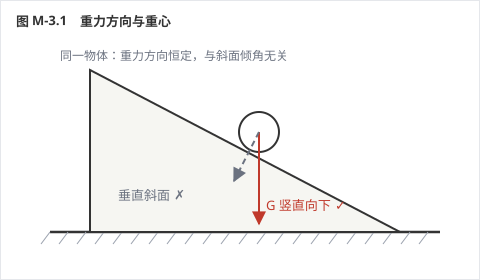
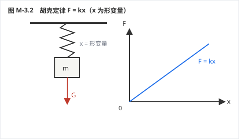
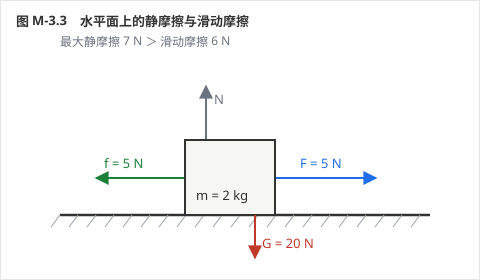
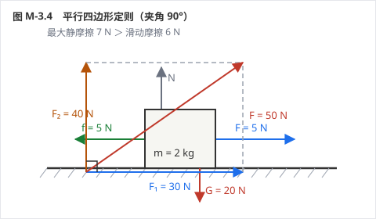
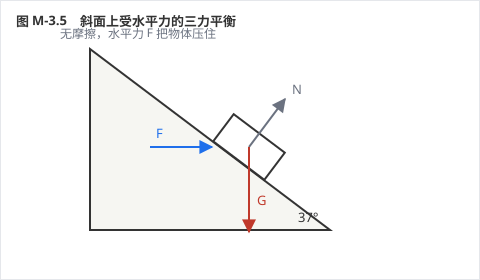
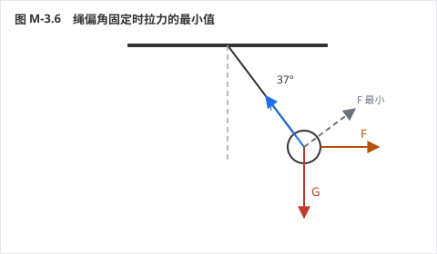
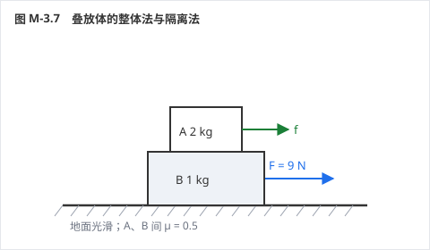
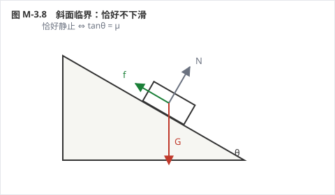

# 力学 · 单元二：相互作用与物体平衡

> **状态**：【样章待验收　v5 版】
> **覆盖**：A-3.1 ～ A-3.8，共 8 考点 / 24 道例题 / 8 组限时挑战，配 8 张受力图
> **单元定位**：力学从"描述运动"转向"解释运动"的转折点。**受力分析做不对，后面牛顿定律、功能关系全部作废**——所以这一单元宁可慢，也要把图会画。

## 🗺️ 关卡地图

| 关 | 考点 | 难度 | 星级 |
|---|---|---|---|
| 1 | 重力与重心 | ★ | ☆☆☆ |
| 2 | 弹力与胡克定律 | ★★ | ☆☆☆ |
| 3 | 摩擦力 | ★★★ | ☆☆☆ |
| 4 | 力的合成与分解 | ★★ | ☆☆☆ |
| 5 | 共点力平衡 | ★★★ | ☆☆☆ |
| 6 | 动态平衡 | ★★★★ | ☆☆☆ |
| 7 | 整体法与隔离法 | ★★★ | ☆☆☆ |
| 8 | 临界与极值 | ★★★★ | ☆☆☆ |

---

## A-3.1 重力与重心

*力学 › 必修一 第3章 相互作用与力的平衡 ｜ Ⅰ · 考频低 ｜ 前置：无 ｜ 关联：A-3.4*

**⚡ 先猜**：物体放在斜面上，重力的方向是"垂直斜面向下"吗？

### 30 秒概述

重力方向永远是**竖直向下**——垂直于水平面，不管你放在斜面上还是斜面上滚。重心是重力的等效作用点，它可以在物体外面（比如圆环的中心）。

### 30 秒自评

1. 重力的方向总是垂直于接触面向下。
2. 物体的重心一定在物体上。
3. 质量分布均匀的球体，重心在球心。

> **答案**：1. ✗（竖直向下，不垂直于斜面）　2. ✗（圆环重心在圆心）　3. ✓

### 🔑 原理与公式

- **G = mg**，方向**竖直向下**（垂直于水平面，不一定指向地心）
- 重心：重力等效作用点，与质量分布、形状有关；可用**悬挂法**测定薄板重心
- g 随纬度升高略增大、随高度升高略减小；上海实测 ≈ 9.79 m/s²

**适用条件**：g 在一般计算中取 10；物体随地球自转的向心力是万有引力的一个极小分力，中学阶段忽略。

**易错边界**
1. "竖直向下"被当成"垂直斜面向下"
2. 认为重心一定在物体上
3. 认为"超重失重时重力变了"（重力不变，是视重变了）

### 例题 1 · L1 基础

质量 60 kg 的人在教室里。求他受到的重力（g 取 9.8）；若把他"搬到"月球（g 月 = 1.6 m/s²），质量和重力各是多少？

**解析**：
地球：G = 60 × 9.8 = **588 N**，方向竖直向下
月球：质量仍为 **60 kg**（质量是物体的属性，与位置无关）；重力 = 60 × 1.6 = **96 N**

**💥 陷阱**：说"到月球上质量变小了"。质量不变，变的是重力。

**变式**：同一个弹簧秤在地球称得 588 N，在月球称得多少？（96 N，弹簧秤测的是重力）

### 例题 2 · L2 常考

判断下列说法：
(1) 舞蹈演员的重心一定在她身体上；
(2) 一块形状不规则的薄板，可用悬挂法确定重心；
(3) 重心就是物体上最重的那一点。

**解析**：
(1) ✗——下腰时重心可能落在身体之外
(2) ✓——悬挂两次，两条竖直线交点即重心
(3) ✗——重心是等效作用点，不是"最重的点"

**💥 陷阱**：把"重心"理解成"质量最大的位置"。它只是一个力的作用点，与质量分布有关，与"哪块最重"无关。

**变式**：一个均匀圆环的重心在哪里？（圆心，不在环上）

### 例题 3 · L3 综合

物体静止在倾角 30° 的斜面上。
(1) 画出它的重力，并说明方向；
(2) 把重力沿"垂直斜面"和"平行斜面"两个方向分解，求两个分量（G = 20 N）；
(3) 若斜面变陡到 60°，哪一部分变大、哪一部分变小？

**解析**：
(1) 重力**竖直向下**，与斜面无关（见图）
(2) 平行斜面：G sin30° = **10 N**；垂直斜面：G cos30° ≈ **17.3 N**
(3) 倾角增大：**平行分量变大**（sin 增大），**垂直分量变小**（cos 减小）——这正是"陡坡更容易下滑"的原因

**💥 陷阱**：把重力画成"垂直斜面向下"。看图：虚线那个方向是错的，重力始终竖直。

**变式**：倾角为 θ 时，两个分量分别是多少？（G sinθ、G cosθ）

### ⏱️ 限时挑战（90 秒）

① 判断：重力方向总是指向地心。② 判断：重心可以在物体之外。

> 答案：① ✗（只有赤道和两极才指向地心）　② ✓

### ✅ 接下来做什么

你刚才做了 **3 道自评题**，先数一下对了几道：

- **3 道全对** → 这个考点你已经会了。直接做「例题 3」+ 它的变式；两题都对，就跳到下一个考点。
- **对 2 道** → 先读上面的「易错边界」，再做「例题 2」和「例题 3 的变式」。
- **对 0–1 道** → 从「原理与公式」开始，按顺序把例题 1、2、3 做完。

> **按年级的过关线**：高一做到例题 1 就行｜高二做到例题 2｜高三要例题 3 和变式都对。

---

## A-3.2 弹力与胡克定律

*力学 › 必修一 第3章 相互作用与力的平衡 ｜ Ⅱ · 考频中 ｜ 前置 A-3.1 ｜ 关联 A-3.5*

**⚡ 先猜**：把一根弹簧剪成等长的两段，每段的劲度系数是变大还是变小？

### 30 秒概述

弹力是"形变后想恢复原状"产生的力。胡克定律 **F = kx** 里的 x 是**形变量**（伸长或压缩了多少），不是弹簧的长度。k 由弹簧本身决定：**越短越硬**，剪一半，k 变两倍。

### 30 秒自评

1. 胡克定律 F = kx 中，x 是弹簧的长度。
2. 绳只能提供拉力，不能提供推力。
3. 弹簧剪成等长两段后，每段的劲度系数变为原来的 2 倍。

> **答案**：1. ✗（是形变量）　2. ✓（绳只能拉）　3. ✓（k 与长度成反比）

### 🔑 原理与公式

- **F = kx**：x 为形变量 [m]，k 为劲度系数 [N/m]
- 弹力方向：面接触**垂直于接触面**；绳**沿绳**指向收缩方向；杆可沿任意方向（可拉可推）
- 弹簧串联：1/k = 1/k₁ + 1/k₂（变软）；并联：k = k₁ + k₂（变硬）
- 剪断弹簧：k 与长度成反比，剪半则 k 翻倍

**适用条件**：胡克定律只在**弹性限度内**成立；超过限度弹簧永久变形。

**易错边界**
1. x 用弹簧长度代入
2. 认为杆的弹力一定沿杆（杆可以给任意方向的力）
3. 认为弹簧秤两端各用 5 N 拉，读数就是 10 N

### 例题 1 · L1 基础

弹簧原长 10 cm，挂 2 N 重物时长度变为 12 cm。求劲度系数；若挂 5 N 重物，弹簧多长？

**解析**：
1. 形变量 x = 12 − 10 = 2 cm = 0.02 m
2. k = F/x = 2/0.02 = **100 N/m**
3. 挂 5 N：x' = 5/100 = 0.05 m = 5 cm ⇒ 长度 = 10 + 5 = **15 cm**

**💥 陷阱**：用 12 cm 直接当 x，得 k = 16.7 N/m。x 是"伸长量"，不是"现在的长度"。

**变式**：若挂 3 N，长度多少？（13 cm）

### 例题 2 · L2 常考

(1) 弹簧秤两端各用 5 N 的力向外拉，读数是多少？
(2) 把例 1 的弹簧剪成等长的两段，取其中一段挂 2 N 重物，伸长多少？

**解析**：
(1) 弹簧秤显示的是**一端受到的拉力**，读数 **5 N**（墙那一端只是提供反作用力）
(2) 剪半后 k' = 2k = **200 N/m**，x = 2/200 = 0.01 m = **1 cm**

**💥 陷阱**：(1) 答 10 N——把两端拉力相加；(2) 认为剪短后更软。

**变式**：两段都挂同一个 2 N 重物，总伸长多少？（各 1 cm，共 2 cm，与原来相同）

### 例题 3 · L3 综合

质量 2 kg 的物体放在倾角 37° 的光滑斜面上，用一根平行于斜面的弹簧拉住，物体静止。弹簧劲度系数 k = 100 N/m，g 取 10。求弹簧的伸长量。

**解析**：
1. 沿斜面方向：物体受重力分量 mg sin37° 向下、弹簧拉力 kx 向上
2. 平衡：kx = mg sin37° = 20 × 0.6 = 12 N
3. x = 12/100 = **0.12 m = 12 cm**

**💥 陷阱**：用 mg = 20 N 代入，得 20 cm。斜面上重力的"有效部分"只有 mg sinθ。

**变式**：若斜面粗糙、μ = 0.5，且弹簧被压缩（物体有上滑趋势），伸长量是多少？
（kx = mg sin37° + μmg cos37° = 12 + 8 = 20 N ⇒ x = 0.2 m）

### ⏱️ 限时挑战（90 秒）

① k = 200 N/m，伸长 3 cm，弹力多大？② 判断：弹簧越长，劲度系数越大。

> 答案：① 6 N　② ✗（越长越软）

### ✅ 接下来做什么

你刚才做了 **3 道自评题**，先数一下对了几道：

- **3 道全对** → 这个考点你已经会了。直接做「例题 3」+ 它的变式；两题都对，就跳到下一个考点。
- **对 2 道** → 先读上面的「易错边界」，再做「例题 2」和「例题 3 的变式」。
- **对 0–1 道** → 从「原理与公式」开始，按顺序把例题 1、2、3 做完。

> **按年级的过关线**：高一做到例题 1 就行｜高二做到例题 2｜高三要例题 3 和变式都对。

---

## A-3.3 摩擦力

*力学 › 必修一 第3章 相互作用与力的平衡 ｜ Ⅱ · 考频**高** ｜ 前置 A-3.2 ｜ 关联 A-3.5、A-3.8　★*

**⚡ 先猜**：静止的物体一定受静摩擦力吗？运动的物体一定受滑动摩擦力吗？

### 30 秒概述

摩擦力的方向看"**相对**运动（趋势）"，不看绝对运动——所以传送带上的物块可以和带一起向前加速，靠的就是向前的静摩擦。大小上，**滑动摩擦用 f = μN，静摩擦只能用平衡条件求**，这是最容易混的一处。

### 30 秒自评

1. 滑动摩擦力 f = μN 中，N 一定等于物体的重力。
2. 静摩擦力的大小由物体的平衡条件或牛顿第二定律决定。
3. 摩擦力总是阻碍物体的运动。

> **答案**：1. ✗（斜面、墙面、加速系统中 N ≠ mg）　2. ✓　3. ✗（可以是动力）

### 🔑 原理与公式

- **滑动摩擦**：f = μN，方向与**相对运动**方向相反
- **静摩擦**：0 ≤ f ≤ f_max，大小由平衡条件/牛顿第二定律求，方向与**相对运动趋势**相反
- 最大静摩擦略大于滑动摩擦，计算中常取 f_max ≈ μN

**适用条件**：f = μN 只适用于滑动摩擦；静摩擦**绝不能**直接代 μN（那是最大值，不是实际值）。

**易错边界**
1. N ≠ mg（斜面、竖直墙面、有竖直加速度时）
2. 静摩擦直接代 μN
3. 认为摩擦力一定做负功（传送带上就是动力）

### 例题 1 · L1 基础

质量 2 kg 的物体静止在水平面上，动摩擦因数 μ = 0.3，最大静摩擦 7 N。用 5 N 的水平力拉它，物体受到的摩擦力多大？

**解析**：
1. 先看能不能拉动：5 N < 7 N（最大静摩擦）⇒ 物体**保持静止**
2. 静止 ⇒ 水平方向平衡 ⇒ 静摩擦 f = 拉力 = **5 N**，方向与拉力相反

**💥 陷阱**：直接算 f = μmg = 6 N。物体根本没动，摩擦力只有 5 N——静摩擦是"按需供给"的。

**变式**：若拉力增大到 7 N，摩擦力多大？（7 N，恰好达到最大静摩擦，临界）

### 例题 2 · L2 常考

承上题。若改用 10 N 的水平力拉，物体受到的摩擦力多大？加速度多大？

**解析**：
1. 10 N > 7 N ⇒ 物体**滑动**
2. 滑动摩擦 f = μmg = 0.3 × 20 = **6 N**
3. 合力 = 10 − 6 = 4 N ⇒ a = 4/2 = **2 m/s²**

**💥 陷阱**：用 7 N 当滑动摩擦。滑动后，摩擦力由 μN 决定（6 N），不再等于最大静摩擦（7 N）。

**变式**：若 μ = 0.5，10 N 拉力下加速度多大？（f = 10 N，a = 0，恰好匀速）

### 例题 3 · L3 综合

质量 2 kg 的物体从倾角 37° 的斜面顶端下滑，动摩擦因数 μ = 0.5，g 取 10。求下滑加速度；并判断：若把斜面倾角减小到 30°，物体会不会自己滑下来？

**解析**：
1. 沿斜面：mg sin37° = 12 N 向下；摩擦力 f = μmg cos37° = 0.5 × 16 = 8 N 向上
2. 合力 = 12 − 8 = 4 N ⇒ a = **2 m/s²**
3. 倾角 30°：重力分量 = 10 N，最大静摩擦 ≈ μmg cos30° = 8.7 N
   10 N > 8.7 N ⇒ **仍会下滑**，但加速度更小

**💥 陷阱**：把摩擦力算成 μmg = 10 N（用 mg 而不是 mg cosθ 当正压力）。

**变式**：μ 多大时物体恰好能静止在 37° 斜面上？（tan37° = 0.75）

### ⏱️ 限时挑战（90 秒）

① 判断：摩擦力一定是阻力。② 斜面上 μ = 0.5、θ = 37°，物体下滑加速度多大？

> 答案：① ✗（可以是动力）　② 2 m/s²

### ✅ 接下来做什么

你刚才做了 **3 道自评题**，先数一下对了几道：

- **3 道全对** → 这个考点你已经会了。直接做「例题 3」+ 它的变式；两题都对，就跳到下一个考点。
- **对 2 道** → 先读上面的「易错边界」，再做「例题 2」和「例题 3 的变式」。
- **对 0–1 道** → 从「原理与公式」开始，按顺序把例题 1、2、3 做完。

> **按年级的过关线**：高一做到例题 1 就行｜高二做到例题 2｜高三要例题 3 和变式都对。

---

## A-3.4 力的合成与分解

*力学 › 必修一 第3章 相互作用与力的平衡 ｜ Ⅱ · 考频中 ｜ 前置 A-3.1 ｜ 关联 A-3.5*

**⚡ 先猜**：两个力的合力，一定比每个分力都大吗？

### 30 秒概述

力的合成用**平行四边形定则**，合力范围是 |F₁−F₂| ≤ F ≤ F₁+F₂——所以合力**可以比分力小**。分解是合成的逆运算，正交分解的价值在于"让尽量多的力落在坐标轴上"，少算三角函数。

### 30 秒自评

1. 两个力的合力范围是 |F₁ − F₂| ≤ F ≤ F₁ + F₂。
2. 合力一定大于每一个分力。
3. 正交分解时，应尽量让更多的力落在坐标轴上。

> **答案**：1. ✓　2. ✗（夹角大时可以更小）　3. ✓

### 🔑 原理与公式

- **平行四边形定则**：以两分力为邻边作平行四边形，对角线即合力
- **三角形定则**：两分力首尾相接，合力由起点指向终点
- 合力范围：**|F₁ − F₂| ≤ F ≤ F₁ + F₂**
- 正交分解：F_x = F cosθ，F_y = F sinθ

**适用条件**：只适用于共点力；分解方式不唯一，按"解题方便"选。

**易错边界**
1. 认为合力一定大于分力
2. 分解时不说明"沿哪个方向分解"
3. 三力平衡时把"任意两力的合力"与"第三个力"方向搞反

### 例题 1 · L1 基础

F₁ = 30 N、F₂ = 40 N，夹角 90°。求合力大小。

**解析**：勾股定理：F = √(30² + 40²) = **50 N**
方向：与 F₁ 成 53°（tanθ = 40/30）

**💥 陷阱**：直接相加得 70 N。只有**同向**才相加。

**变式**：两力同向、反向时合力各是多少？（70 N，10 N）

### 例题 2 · L2 常考

同上两力，夹角分别为 60° 和 120°，求合力大小。

**解析**：
1. 余弦定理：F = √(F₁² + F₂² + 2F₁F₂cosθ)
2. 60°：F = √(900 + 1600 + 2×30×40×0.5) = √3700 ≈ **60.8 N**
3. 120°：F = √(900 + 1600 + 2400×(−0.5)) = √1300 ≈ **36.1 N**

**💥 陷阱**：120° 时合力 36.1 N **小于** F₂ = 40 N——这直接推翻了"合力最大"的直觉。

**变式**：夹角多大时合力等于 50 N？（90°；夹角 180° 时合力 10 N）

### 例题 3 · L3 综合

质量 2 kg 的物体放在倾角 37° 的斜面上（g = 10）。
(1) 把重力沿"垂直斜面"和"平行斜面"分解，求两个分量；
(2) 说明为什么"垂直分量"决定了压力；
(3) 若改用水平-竖直坐标系分解，重力的两个分量是多少？

**解析**：
(1) 平行斜面：20 sin37° = **12 N**；垂直斜面：20 cos37° = **16 N**
(2) 物体对斜面的压力与"垂直斜面方向的支持力"是一对相互作用力，而支持力由垂直斜面的重力分量平衡 ⇒ N = 16 N（无其他垂直方向外力时）
(3) 竖直分量 20 N、水平分量 **0**（重力本来就竖直）

**💥 陷阱**：(2) 认为压力等于重力 20 N。斜面"分摊"了一部分，压力只有 16 N——所以斜面上摩擦力 μN 比水平面小。

**变式**：为什么斜面上 μ 要更大才能"停住"？（N 变小 ⇒ 最大静摩擦变小，而下滑分量变大）

### ⏱️ 限时挑战（90 秒）

① F₁ = F₂ = 10 N，夹角 120°，合力多大？② 判断：分解一个力只有一种方式。

> 答案：① 10 N　② ✗（不唯一）

### ✅ 接下来做什么

你刚才做了 **3 道自评题**，先数一下对了几道：

- **3 道全对** → 这个考点你已经会了。直接做「例题 3」+ 它的变式；两题都对，就跳到下一个考点。
- **对 2 道** → 先读上面的「易错边界」，再做「例题 2」和「例题 3 的变式」。
- **对 0–1 道** → 从「原理与公式」开始，按顺序把例题 1、2、3 做完。

> **按年级的过关线**：高一做到例题 1 就行｜高二做到例题 2｜高三要例题 3 和变式都对。

---

## A-3.5 共点力平衡

*力学 › 必修一 第3章 相互作用与力的平衡 ｜ Ⅱ · 考频**高** ｜ 前置 A-3.4 ｜ 关联 A-3.6、A-3.7　★*

**⚡ 先猜**：三个力作用下物体平衡，任意两个力的合力与第三个力是什么关系？

### 30 秒概述

平衡就是 **ΣF = 0**，不是"速度为零"（匀速运动也平衡）。三个力平衡时，任意两个力的合力与第三个力**等大反向**，三力首尾相接构成闭合三角形——这句话能秒掉一大半平衡题。

### 30 秒自评

1. 三力平衡时，任意两个力的合力与第三个力等大反向。
2. 物体速度为零时一定处于平衡状态。
3. 正交分解列平衡方程：ΣFx = 0，ΣFy = 0。

> **答案**：1. ✓　2. ✗（瞬时速度为零但加速度不为零，如上抛最高点）　3. ✓

### 🔑 原理与公式

- 平衡条件：**ΣF = 0**（正交分解：ΣFx = 0，ΣFy = 0）
- 三力平衡：任意两力的合力与第三力**等大反向**；三力构成**闭合三角形**
- 解题步骤：选对象 → 受力分析（画图）→ 建系 → 列方程

**适用条件**：共点力；"缓慢移动"过程中每一时刻都可视为平衡（动态平衡）。

**易错边界**
1. 把"速度为零"等同"平衡"（上抛最高点）
2. 漏画力（最常漏：摩擦力、支持力）
3. 三力平衡时把方向搞反（合力与第三力反向）

### 例题 1 · L1 基础

质量 2 kg 的物体放在倾角 37° 的光滑斜面上，用水平方向的力 F 推住使其静止（g = 10）。求 F 和斜面对物体的支持力 N。

**解析**：
1. 取水平-竖直坐标：N 的竖直分量平衡重力，水平分量平衡 F
2. 竖直：N cos37° = mg = 20 ⇒ N = **25 N**
3. 水平：F = N sin37° = 25 × 0.6 = **15 N**

**💥 陷阱**：用 F = mg sin37° = 12 N。水平力不是沿斜面方向的，必须走正交分解。

**变式**：若 F 改为"沿斜面向上"，F 多大？（mg sin37° = 12 N，此时 N = 16 N）

### 例题 2 · L2 常考

轻杆水平固定在墙上，杆端系一根绳并悬挂 20 N 的重物，绳与**竖直方向**的夹角为 37°。求绳的拉力 T 和杆对结点的作用力 N。

**解析**：
1. 结点受三个力：绳拉力 T（沿绳斜向上）、杆的力 N（沿杆水平）、重力 20 N（竖直向下）
2. 竖直方向：T cos37° = 20 ⇒ T = 20/0.8 = **25 N**
3. 水平方向：N = T sin37° = 25 × 0.6 = **15 N**（杆对结点是推力）

**💥 陷阱**：把"与竖直方向成 37°"当成"与水平方向成 37°"，写成 T sin37° = 20 ⇒ T ≈ 33 N。**角度的参照物必须先看清**，这是平衡题第一号失分点。

**变式**：若绳与竖直方向成 53°，T 和 N 各是多少？（T = 20/cos53° ≈ 33.3 N，N = 20 tan53° ≈ 26.7 N）

### 例题 3 · L3 综合

小球重 20 N，用两根绳悬挂：绳 OA 与竖直方向成 30°，绳 OB 水平。求两绳的拉力。

**解析**：
1. 以结点为对象，三力：T_A（沿 OA 斜向上）、T_B（水平）、G = 20 N
2. 竖直：T_A cos30° = 20 ⇒ T_A = 20/0.866 ≈ **23.1 N**
3. 水平：T_B = T_A sin30° ≈ 23.1 × 0.5 ≈ **11.5 N**

**💥 陷阱**：把 30° 当成"与水平方向的夹角"，算出 T_A = 20/sin30° = 40 N。**角度基准必须看清**，这是平衡题最高频的失分点。

**变式**：若把 OB 绳剪断，小球摆到最低点时绳 OA 的拉力是多少？（超过 20 N，属圆周运动，见单元四）

### ⏱️ 限时挑战（90 秒）

① 三力平衡，其中两力为 3 N 和 4 N，第三力可能是 6 N 吗？② 判断：物体做匀速直线运动时处于平衡状态。

> 答案：① 可以（3+4 > 6）　② ✓

### ✅ 接下来做什么

你刚才做了 **3 道自评题**，先数一下对了几道：

- **3 道全对** → 这个考点你已经会了。直接做「例题 3」+ 它的变式；两题都对，就跳到下一个考点。
- **对 2 道** → 先读上面的「易错边界」，再做「例题 2」和「例题 3 的变式」。
- **对 0–1 道** → 从「原理与公式」开始，按顺序把例题 1、2、3 做完。

> **按年级的过关线**：高一做到例题 1 就行｜高二做到例题 2｜高三要例题 3 和变式都对。

---

## A-3.6 动态平衡

*力学 › 必修一 第3章 相互作用与力的平衡 ｜ Ⅱ · 考频**高** ｜ 前置 A-3.5 ｜ 关联 A-2.7　★*

**⚡ 先猜**：挡板缓慢倒下时，球对挡板的压力是一直变大吗？

### 30 秒概述

动态平衡的题眼是"**缓慢**"——每一时刻都平衡。解法只有一条主线：找到**不变的力**（通常是重力）和**方向不变的力**，第三个力转动时，三个力构成**矢量三角形**，边长的变化就是力的大小变化。

### 30 秒自评

1. 动态平衡中，若一个力大小方向不变、一个力方向不变，可用矢量三角形分析。
2. 求某个力的最小值时，该力与另一个力垂直时最小。
3. "缓慢移动"过程中，物体每一时刻都可视为平衡。

> **答案**：1. ✓　2. ✓　3. ✓

### 🔑 原理与公式

- 矢量三角形法：G 恒定（大小方向）、N 方向不变、F 方向变化 ⇒ 画三角形看边长
- **最小力**：当某力与另一力垂直时取最小值
- 相似三角形法：力的三角形与几何三角形相似时，用边长比求力

**适用条件**：缓慢移动（每时刻平衡）；三力且其中至少一力方向不变。

**易错边界**
1. 把"转动过程中力一直变大"想当然（多数是先减后增）
2. 最小力条件记成"与重力垂直"（应是**与另一力垂直**）
3. 忘记"缓慢"意味着可以逐时刻列平衡方程

### 例题 1 · L1 基础

小球重 20 N，用绳悬挂，用水平力 F 把球拉偏，使绳与竖直方向成 37°。求绳的拉力 T 和 F。

**解析**：
1. 三力：T（沿绳）、F（水平）、G = 20 N（竖直）
2. 竖直：T cos37° = 20 ⇒ T = **25 N**
3. 水平：F = T sin37° = 25 × 0.6 = **15 N**

**💥 陷阱**：用 T = 20/cos37° 后忘记 F 要用 T 去求，直接写 F = 20 tan37° 也对——但角度基准一错就全错。

**变式**：绳偏角增大到 45°，T 和 F 各是多少？（T ≈ 28.3 N，F = 20 N）

### 例题 2 · L2 常考

承上题：保持绳与竖直方向成 37° 不变，但**改变 F 的方向**。求 F 的最小值及此时绳的拉力。

**解析**：
1. 三个力构成闭合三角形：G 竖直向下、T 沿绳、F 任意方向
2. F 最小时，F 与 T **垂直**（点到直线的距离最短）
3. F_min = G sin37° = 20 × 0.6 = **12 N**
4. 此时 T = G cos37° = **16 N**

**💥 陷阱**：认为"F 水平时最小"（15 N）。水平方向不是最短距离，垂直绳方向才是。

**变式**：若绳偏角为 θ，F 的最小值是多少？（G sinθ）

### 例题 3 · L3 综合

光滑斜面上放一个球，用一块挡板挡住。挡板绕底端缓慢地从竖直位置转到水平位置。
(1) 球对挡板的压力如何变化？
(2) 球对斜面的压力如何变化？
(3) 什么时候挡板压力最小？

**解析**：
1. 球受三力：重力 G（恒定）、斜面支持力 N（方向不变，垂直斜面）、挡板支持力 F（方向随挡板转动）
2. 三力构成矢量三角形：G 固定，N 的方向固定，F 的方向转动
3. F 最小时，F 与 N **垂直**，即挡板与斜面垂直
4. 挡板从竖直转到水平，F 先减小（到与斜面垂直时最小）后增大；N 一直减小

**💥 陷阱**：认为"挡板越平压力越大"或"一直变小"。实际是先减后增，最小值在"挡板⊥斜面"处——这个位置恰好也是"挡板最短"的位置。

**变式**：若挡板从水平缓慢转到竖直，结论如何？（F 先减后增，最小值仍在挡板⊥斜面时）

### ⏱️ 限时挑战（90 秒）

① 动态平衡中，F 与哪个力垂直时 F 最小？② 判断：缓慢移动过程中，物体所受合力始终为零。

> 答案：① 与另一个"方向不变的力"垂直　② ✓

### ✅ 接下来做什么

你刚才做了 **3 道自评题**，先数一下对了几道：

- **3 道全对** → 这个考点你已经会了。直接做「例题 3」+ 它的变式；两题都对，就跳到下一个考点。
- **对 2 道** → 先读上面的「易错边界」，再做「例题 2」和「例题 3 的变式」。
- **对 0–1 道** → 从「原理与公式」开始，按顺序把例题 1、2、3 做完。

> **按年级的过关线**：高一做到例题 1 就行｜高二做到例题 2｜高三要例题 3 和变式都对。

---

## A-3.7 整体法与隔离法

*力学 › 必修一 第3章 相互作用与力的平衡 ｜ Ⅱ · 考频**高** ｜ 前置 A-3.5 ｜ 关联 A-4（牛顿定律）*

**⚡ 先猜**：要求 A、B 之间的摩擦力，能对"A+B 整体"列方程吗？

### 30 秒概述

**求外力用整体，求内力用隔离**。整体法的好处是不用管内部的一堆相互作用；但 A、B 之间的摩擦力、弹力属于内力，整体法看不见——必须隔离出来。

### 30 秒自评

1. 整体法可以求出系统内部物体之间的作用力。
2. 当系统内各物体加速度相同时，可以把它们当成一个整体分析。
3. 求内力时必须用隔离法。

> **答案**：1. ✗（整体法只看得见外力）　2. ✓　3. ✓

### 🔑 原理与公式

- **整体法**：把系统当一个物体，只分析外力，求加速度
- **隔离法**：把某个物体单独取出，分析它受的所有力，求内力
- 常用组合：**整体求 a → 隔离求内力**

**适用条件**：整体法要求各物体**加速度相同**（相对静止或一起运动）；加速度不同时不能用。

**易错边界**
1. 用整体法去求内力（求不出来，或求出 0）
2. 隔离时漏掉"另一个物体给它的力"
3. 整体法忘记把内力"抵消"（内力在整体中不出现）

### 例题 1 · L1 基础

质量 2 kg 的 A 叠放在质量 1 kg 的 B 上，B 放在光滑水平面上。用 9 N 的水平力拉 B，A、B 保持相对静止，A、B 间动摩擦因数 μ = 0.5（g = 10）。求 A、B 的加速度和 A 受到的摩擦力。

**解析**：
1. **整体法**求加速度：a = F/(m_A + m_B) = 9/3 = **3 m/s²**
2. **隔离 A**：A 只受 B 给它的静摩擦力（水平方向）⇒ f = m_A·a = 2 × 3 = **6 N**，方向与 F 相同
3. 校验：f_max = μ m_A g = 0.5 × 20 = 10 N > 6 N ⇒ 确实相对静止 ✓

**💥 陷阱**：对 A 用 f = μN = 10 N。那是**最大值**，实际只有 6 N。

**变式**：若地面也粗糙（μ地 = 0.2），加速度多大？（a = (9 − 6)/3 = 1 m/s²）

### 例题 2 · L2 常考

承上题。逐渐增大拉力 F，A、B 恰好要发生相对滑动时，F 多大？

**解析**：
1. 临界条件：A 受到的摩擦力达到最大静摩擦 f_max = 10 N
2. 此时 A 的加速度 a = f_max/m_A = 10/2 = **5 m/s²**
3. 整体：F = (m_A + m_B)a = 3 × 5 = **15 N**

**💥 陷阱**：直接用 f_max 当 F（10 N）。F 还要同时给 B 提供加速度。

**变式**：若 F = 20 N，A、B 之间摩擦力多大？（已相对滑动，f = μ m_A g = 10 N）

### 例题 3 · L3 综合

质量 2 kg 的 A 叠在质量 3 kg 的 B 上，B 放在光滑水平面上。水平力 F 作用在 **A** 上，A、B 间动摩擦因数 μ = 0.4（g = 10）。求保持 A、B 相对静止的最大拉力 F。

**解析**：
1. 临界时 B 受到的摩擦力达到最大：f_max = μ m_A g = 0.4 × 20 = **8 N**
2. B 的加速度上限：a = f_max/m_B = 8/3 ≈ **2.67 m/s²**
3. 整体：F = (m_A + m_B)a = 5 × 2.67 ≈ **13.3 N**

**💥 陷阱**：把 F 作用在 A 上却用"B 的摩擦力"去算 A 的加速度。力作用在谁身上，谁的运动方程里就有它。

**变式**：若 F 作用在 B 上（从下方拉），最大 F 是多少？（f_max 仍 8 N，A 的 a = 8/2 = 4 m/s²，F = 5×4 = 20 N）

### ⏱️ 限时挑战（90 秒）

① 整体法能求内力吗？② 判断：加速度不同的两个物体也能用整体法。

> 答案：① 不能　② ✗（加速度相同才行）

### ✅ 接下来做什么

你刚才做了 **3 道自评题**，先数一下对了几道：

- **3 道全对** → 这个考点你已经会了。直接做「例题 3」+ 它的变式；两题都对，就跳到下一个考点。
- **对 2 道** → 先读上面的「易错边界」，再做「例题 2」和「例题 3 的变式」。
- **对 0–1 道** → 从「原理与公式」开始，按顺序把例题 1、2、3 做完。

> **按年级的过关线**：高一做到例题 1 就行｜高二做到例题 2｜高三要例题 3 和变式都对。

---

## A-3.8 临界与极值

*力学 › 必修一 第3章 相互作用与力的平衡 ｜ Ⅱ · 考频**高** ｜ 前置 A-3.3、A-3.5 ｜ 关联 A-3.7　★*

**⚡ 先猜**：物体在斜面上"恰好不下滑"时，动摩擦因数 μ 和倾角 θ 是什么关系？

### 30 秒概述

题里出现"恰好""刚要""最大""最小"，就是在喊临界。临界只有三种：**摩擦力达到最大静摩擦**、**支持力为零（刚要离开）**、**绳刚要松弛（拉力为零）**。找到是哪一个，方程就列得出来。

### 30 秒自评

1. 物体在斜面上恰好静止的条件是 tanθ = μ。
2. "恰好滑动"意味着摩擦力为零。
3. 支持力 N = 0 是物体"刚要离开接触面"的临界条件。

> **答案**：1. ✓　2. ✗（是达到最大静摩擦）　3. ✓

### 🔑 原理与公式

- **斜面临界**：恰好不下滑 ⇔ mg sinθ = μ mg cosθ ⇔ **tanθ = μ**
- **压墙临界**：水平力 F 把物体压在竖直墙上不下滑 ⇔ μF ≥ mg ⇔ **F_min = mg/μ**
- 通用方法：找临界条件 → 列方程 → 解出临界值

**适用条件**：最大静摩擦 ≈ μN；"恰好"类问题只考虑临界瞬间，不考虑过程。

**易错边界**
1. 把"恰好"当成"摩擦力为零"
2. 压墙问题里把 N 当成 mg（N 是水平力 F 产生的）
3. 斜面上有外力时仍套 tanθ = μ

### 例题 1 · L1 基础

物体放在可调倾角的斜面上，动摩擦因数 μ = 0.5。求它能保持静止的最大倾角。

**解析**：
1. 恰好静止：mg sinθ = μ mg cosθ
2. 两边约去 mg cosθ：tanθ = μ = 0.5
3. θ = arctan0.5 ≈ **26.6°**（约 27°）

**💥 陷阱**：答 30°（以为 sin30° = 0.5 就对应 μ = 0.5）。关系是 tanθ = μ，不是 sinθ = μ。

**变式**：μ = 1 时，最大倾角多少？（45°）

### 例题 2 · L2 常考

质量 2 kg 的物体被水平力 F 压在竖直墙面上，物体与墙的动摩擦因数 μ = 0.4（g = 10）。要使物体不滑下来，F 至少多大？

**解析**：
1. 竖直方向：静摩擦平衡重力 ⇒ f = mg = 20 N
2. 静摩擦上限：f ≤ μN = μF
3. 临界：μF = mg ⇒ F = mg/μ = 20/0.4 = **50 N**

**💥 陷阱**：用 f = μmg = 8 N 去和重力比。这里 N 是**水平推力 F**，不是重力。

**变式**：若 F = 100 N，摩擦力多大？（20 N，静摩擦"按需"）

### 例题 3 · L3 综合

质量 2 kg 的物体放在倾角 37° 的斜面上，动摩擦因数 μ = 0.5，用水平方向的力 F 推它（g = 10）。求使物体保持静止的 F 的范围。

**解析**：
1. 正交分解（沿斜面/垂直斜面）：
   沿斜面：F cos37° 向上，mg sin37° = 12 N 向下
   垂直斜面：N = mg cos37° + F sin37° = 16 + 0.6F
2. **F 最大**（物体有上滑趋势，摩擦向下）：
   F cos37° = mg sin37° + μN
   0.8F = 12 + 0.5(16 + 0.6F) = 20 + 0.3F ⇒ 0.5F = 20 ⇒ **F_max = 40 N**
3. **F 最小**（物体有下滑趋势，摩擦向上）：
   F cos37° + μN = mg sin37°
   0.8F + 8 + 0.3F = 12 ⇒ 1.1F = 4 ⇒ **F_min ≈ 3.6 N**
4. 结论：**3.6 N ≤ F ≤ 40 N**

**💥 陷阱**：只算一个方向（多数人只算"推得上去"的最大值），漏掉"推得太小会滑下来"。双向临界是这类题的标志。

**变式**：若 μ 增大到 0.8，F 的范围如何变？（范围变宽：F_min 更小，F_max 更大）

### ⏱️ 限时挑战（90 秒）

① 斜面上"恰好静止"的条件式？② 压墙问题中，正压力 N 由什么提供？

> 答案：① tanθ = μ　② 水平推力 F（不是重力）

### ✅ 接下来做什么

你刚才做了 **3 道自评题**，先数一下对了几道：

- **3 道全对** → 这个考点你已经会了。直接做「例题 3」+ 它的变式；两题都对，就跳到下一个考点。
- **对 2 道** → 先读上面的「易错边界」，再做「例题 2」和「例题 3 的变式」。
- **对 0–1 道** → 从「原理与公式」开始，按顺序把例题 1、2、3 做完。

> **按年级的过关线**：高一做到例题 1 就行｜高二做到例题 2｜高三要例题 3 和变式都对。

---

## 本章公式总表

| # | 公式 | 含义 | 条件 |
|---|---|---|---|
| 1 | G = mg | 重力 | 竖直向下 |
| 2 | F = kx | 胡克定律 | 弹性限度内，x 为形变量 |
| 3 | f = μN | 滑动摩擦 | N 为正压力，不一定等于 mg |
| 4 | 0 ≤ f ≤ f_max | 静摩擦 | 大小由平衡条件定 |
| 5 | F = √(F₁²+F₂²+2F₁F₂cosθ) | 合力 | 共点力 |
| 6 | \|F₁−F₂\| ≤ F ≤ F₁+F₂ | 合力范围 | — |
| 7 | ΣFx = 0，ΣFy = 0 | 平衡条件 | 共点力 |
| 8 | tanθ = μ | 斜面临界 | 恰好静止 |
| 9 | F_min = mg/μ | 压墙不下滑 | 水平力压竖直墙 |

## 本章易错清单

| # | 错误 | 正确 |
|---|---|---|
| 1 | 重力垂直斜面向下 | 竖直向下 |
| 2 | 重心一定在物体上 | 圆环重心在圆心 |
| 3 | F = kx 中 x 是长度 | 是形变量 |
| 4 | 弹簧秤两端各 5 N，读数 10 N | 读数 5 N |
| 5 | 静摩擦代 μN | 用平衡条件求，μN 只是上限 |
| 6 | 摩擦力一定是阻力 | 可以是动力 |
| 7 | 合力一定大于分力 | 120° 时可更小 |
| 8 | 速度为零即平衡 | 上抛最高点不平衡 |
| 9 | 整体法求内力 | 内力必须隔离 |
| 10 | "恰好"= 摩擦力为零 | = 摩擦力最大 |
| 11 | 压墙 N = mg | N = F |
| 12 | 斜面临界 sinθ = μ | tanθ = μ |

## 本章关系边

| 起点 | 终点 | 类型 |
|---|---|---|
| A-3.1 | A-3.4 | 前置（重力分解） |
| A-3.2 | A-3.5 | 前置（弹力参与平衡） |
| A-3.3 | A-3.8 | 前置（临界=最大静摩擦） |
| A-3.4 | A-3.5 | 派生（分解用于平衡） |
| A-3.5 | A-3.6 | 延伸（动态平衡） |
| A-3.5 | A-3.7 | 延伸（系统平衡） |
| A-3.7 | A-4 | 综合（牛顿第二定律） |
