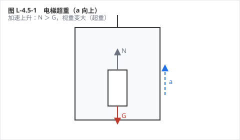
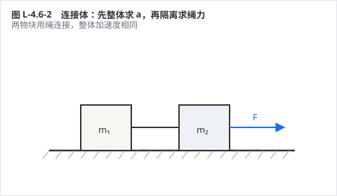
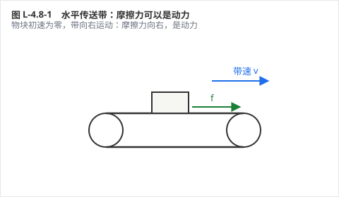
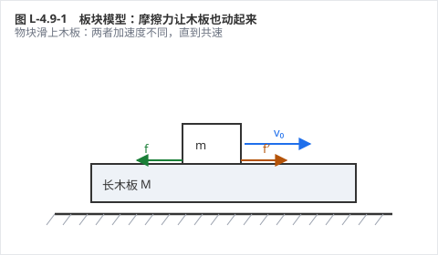

# 力学 · 单元三：牛顿运动定律

> **状态**：【样章待验收　v5 版】
> **覆盖**：A-4.1 ～ A-4.9，共 9 考点 / 27 道例题 / 4 张受力图
> **单元定位**：力学的心脏。前三单元回答"怎么动"，这一单元回答"**为什么这样动**"。牛顿第二定律一旦不稳，后面的曲线运动、万有引力、功能关系全部会塌。

## 🗺️ 关卡地图

| 关 | 考点 | 难度 | 星级 |
|---|---|---|---|
| 1 | 牛顿第一定律与惯性 | ★ | ☆☆☆ |
| 2 | 牛顿第二定律 | ★★★ | ☆☆☆ |
| 3 | 牛顿第三定律 | ★ | ☆☆☆ |
| 4 | 两类动力学问题 | ★★★ | ☆☆☆ |
| 5 | 超重与失重 | ★★ | ☆☆☆ |
| 6 | 连接体问题 | ★★★ | ☆☆☆ |
| 7 | 瞬时性问题 | ★★★★ | ☆☆☆ |
| 8 | 传送带模型 | ★★★★ | ☆☆☆ |
| 9 | 板块模型 | ★★★★ | ☆☆☆ |

---

## A-4.1 牛顿第一定律与惯性

*力学 › 必修一 第4章 牛顿运动定律 ｜ Ⅰ · 考频低 ｜ 前置：无 ｜ 关联：A-4.2*

**⚡ 先猜**：物体要一直运动下去，必须一直有力推着它吗？

### 30 秒概述

两千年前亚里士多德说"力是维持运动的原因"，伽利略用一个**理想斜面**推翻了它：阻力越小，物体滑得越远；阻力为零，它就永远滑下去。所以力不是维持运动的原因，而是**改变**运动状态的原因。

### 30 秒自评

1. 力是维持物体运动的原因。
2. 惯性的大小只与物体的质量有关。
3. 牛顿第一定律可以用实验直接验证。

> **答案**：1. ✗　2. ✓　3. ✗（理想化推理，不能直接验证）

### 🔑 原理与公式

- **牛顿第一定律**：一切物体总保持静止或匀速直线运动状态，直到有外力迫使它改变
- **惯性**：物体保持原有运动状态的性质，是物体固有属性，**只与质量有关**
- 力是**改变**运动状态的原因（产生加速度），不是维持运动的原因

**适用条件**：惯性定律描述的是**不受外力**（或合力为零）的理想情形；现实中只能通过"减小阻力、外推趋势"来验证。

**易错边界**
1. "匀速运动需要力维持"——匀速时合力为零，不需要力
2. "速度越大惯性越大"——惯性只看质量
3. "惯性是一种力"——惯性是性质，不是力

### 例题 1 · L1 基础

伽利略的理想斜面实验：小球从斜面滚下，再滚上另一斜面。减小第二个斜面的倾角，小球滚得更远；若第二个斜面变成水平面，小球将怎样运动？

**解析**：
阻力越小、爬升越"费力"，小球滚得越远。当第二个面变成水平，小球永远达不到原来的高度 ⇒ **以恒定速度一直运动下去**。

**💥 陷阱**：答"慢慢停下来"。停止是因为有摩擦，不是因为"运动需要力"。

**变式**：这个实验能直接验证牛顿第一定律吗？（不能，它是"外推"出来的理想情形）

### 例题 2 · L2 常考

汽车突然刹车时，乘客身体为什么向前倾？安全气囊和安全带分别在防什么？

**解析**：
1. 刹车时车减速，乘客由于**惯性**保持原来的速度 ⇒ 身体相对车向前
2. 安全带防止人撞向仪表台（限制前冲）
3. 安全气囊在碰撞瞬间缓冲，减小人受到的冲击力（延长作用时间）

**💥 陷阱**：说"人被一个向前的力推了出去"。没有这个力——是车减速了，人没减。

**变式**：汽车突然启动时人向后仰，原因相同吗？（相同，都是惯性）

### 例题 3 · L3 综合

甲、乙两球质量相同，甲以 10 m/s 运动，乙以 2 m/s 运动；丙球质量是甲的 3 倍，以 10 m/s 运动。比较三者惯性大小；若要用实验说明"惯性只与质量有关"，应如何控制变量？

**解析**：
1. 惯性只与质量有关 ⇒ 甲、乙惯性相同，丙最大（3 倍）
2. 控制变量：让甲、丙以**相同速度**运动，用相同的力刹车，比较停止所需时间（或距离）——丙更难停下
3. 若要验证"与速度无关"，应让**同一个球**以不同速度运动，比较刹车难易

**💥 陷阱**：认为"速度大的惯性大"。甲比乙快，但惯性一样。

**变式**：为什么满载的卡车刹车距离比空车长？（质量大 ⇒ 惯性大 ⇒ 同样制动力下加速度小）

### ⏱️ 限时挑战（90 秒）

① 惯性大小由什么决定？② 判断：静止的物体没有惯性。

> 答案：① 质量　② ✗（任何物体任何状态都有惯性）

### ✅ 接下来做什么

你刚才做了 **3 道自评题**，先数一下对了几道：

- **3 道全对** → 这个考点你已经会了。直接做「例题 3」+ 它的变式；两题都对，就跳到下一个考点。
- **对 2 道** → 先读上面的「易错边界」，再做「例题 2」和「例题 3 的变式」。
- **对 0–1 道** → 从「原理与公式」开始，按顺序把例题 1、2、3 做完。

> **按年级的过关线**：高一做到例题 1 就行｜高二做到例题 2｜高三要例题 3 和变式都对。

---

## A-4.2 牛顿第二定律

*力学 › 必修一 第4章 牛顿运动定律 ｜ Ⅱ · 考频**高** ｜ 前置 A-4.1、A-3.5 ｜ 关联 A-4.4、A-4.6　★*

**⚡ 先猜**：同样的力，拉空车和拉满载车，加速度一样吗？

### 30 秒概述

**F合 = ma**。三个字要记牢：**合**（不是某一个力）、**同体**（F 和 a 属于同一个物体）、**同向**（a 的方向就是合力的方向）。质量是惯性的量度——同样的力，质量越大，加速度越小。

### 30 秒自评

1. F = ma 中的 F 是物体所受的合力。
2. 加速度的方向总与合力的方向相同。
3. 质量越大，同样的力产生的加速度越大。

> **答案**：1. ✓　2. ✓　3. ✗（越小）

### 🔑 原理与公式

- **F合 = ma**（单位：N = kg·m/s²）
- 四性：**矢量性**（a 与 F合同向）、**瞬时性**（F 变则 a 立刻变）、**同体性**（同一物体）、**独立性**（各方向互不干扰）
- 正交分解：ΣFx = ma_x，ΣFy = ma_y

**适用条件**：惯性参考系；宏观、低速（远小于光速）。

**易错边界**
1. 用某个力代替合力（最常见：漏掉重力或摩擦力）
2. a 的方向与速度方向混为一谈（减速时两者相反）
3. 单位不统一（cm、g 未化成 SI）

### 例题 1 · L1 基础

质量 2 kg 的物体在水平面上，受 10 N 水平拉力，摩擦力 2 N。求加速度。

**解析**：
合力 F合 = 10 − 2 = 8 N
a = F合/m = 8/2 = **4 m/s²**，方向与拉力相同

**💥 陷阱**：直接用 a = 10/2 = 5 m/s²。10 N 是拉力，不是合力。

**变式**：若摩擦力增大到 10 N，加速度多大？（0，匀速）

### 例题 2 · L2 常考

质量 2 kg 的物体从倾角 37° 的斜面下滑，动摩擦因数 0.5（g = 10）。求加速度。

**解析**：
1. 沿斜面：重力分量 mg sin37° = 12 N 向下
2. 摩擦力 f = μmg cos37° = 0.5 × 16 = 8 N 向上
3. 合力 = 4 N ⇒ a = **2 m/s²**

**💥 陷阱**：摩擦力算成 μmg = 10 N。斜面上正压力是 mg cosθ，不是 mg。

**变式**：若 μ = 0.75，加速度多大？（0，匀速下滑）

### 例题 3 · L3 综合

用 100 N 的力竖直向上提升质量 8 kg 的物体（g = 10）。求加速度；若从静止开始提升 2 s，求 2 s 末速度和上升高度。

**解析**：
1. 合力 = 100 − 80 = 20 N ⇒ a = 20/8 = **2.5 m/s²**
2. v = at = 2.5 × 2 = **5 m/s**
3. h = ½at² = ½ × 2.5 × 4 = **5 m**

**💥 陷阱**：把 100 N 直接除以 8 得 12.5 m/s²。竖直方向必须减去重力。

**变式**：若拉力减为 80 N，物体怎样运动？（匀速，a = 0）

### ⏱️ 限时挑战（90 秒）

① 质量 2 kg、合力 6 N，加速度多大？② 判断：加速度方向一定与速度方向相同。

> 答案：① 3 m/s²　② ✗（减速时相反）

### ✅ 接下来做什么

你刚才做了 **3 道自评题**，先数一下对了几道：

- **3 道全对** → 这个考点你已经会了。直接做「例题 3」+ 它的变式；两题都对，就跳到下一个考点。
- **对 2 道** → 先读上面的「易错边界」，再做「例题 2」和「例题 3 的变式」。
- **对 0–1 道** → 从「原理与公式」开始，按顺序把例题 1、2、3 做完。

> **按年级的过关线**：高一做到例题 1 就行｜高二做到例题 2｜高三要例题 3 和变式都对。

---

## A-4.3 牛顿第三定律

*力学 › 必修一 第4章 牛顿运动定律 ｜ Ⅰ · 考频低 ｜ 前置 A-3.2 ｜ 关联 A-4.6*

**⚡ 先猜**：鸡蛋碰石头，鸡蛋碎了。是石头受到的力更大吗？

### 30 秒概述

作用力与反作用力**大小相等、方向相反、作用在两个物体上**，同时产生、同时消失。所以鸡蛋和石头受到的力一样大，碎的原因是鸡蛋"扛不住"。

### 30 秒自评

1. 作用力与反作用力作用在同一个物体上。
2. 作用力与反作用力大小相等、方向相反。
3. 作用力与反作用力可以相互抵消。

> **答案**：1. ✗（两个物体）　2. ✓　3. ✗（不同物体，不能抵消）

### 🔑 原理与公式

- **牛顿第三定律**：两物体间的作用力与反作用力总是大小相等、方向相反、作用在同一条直线上
- 三个"同时"：同时产生、同时变化、同时消失
- 性质相同（都是弹力、都是摩擦力……）

**与平衡力的区别**：平衡力作用在**同一物体**上、可以抵消；作用力与反作用力作用在**两个物体**上、不能抵消。

**易错边界**
1. 把作用力与反作用力当成平衡力
2. 认为"主动施力的一方受力更大"
3. 认为作用力先产生、反作用力后产生

### 例题 1 · L1 基础

判断下列哪一对力是作用力与反作用力：
A. 书受的重力与桌面对书的支持力
B. 书对桌面的压力与桌面对书的支持力
C. 书受的重力与书对桌面的压力
D. 马拉车的力与车受到的摩擦力

**解析**：
A：都作用在书上 ⇒ 平衡力
B：书压桌面、桌面支持书，作用在两个物体上 ⇒ **作用力与反作用力** ✓
C：一个是重力（地球施）、一个是压力（书施），施力物体不同 ⇒ 不是一对
D：不是相互作用 ⇒ 不是

**💥 陷阱**：选 A。重力和支持力确实大小相等方向相反，但都作用在书上，是平衡力。

**变式**：书静止在桌面上，重力和支持力大小相等，能说它们是一对平衡力吗？（可以）

### 例题 2 · L2 常考

马拉车前进时，马拉车的力与车拉马的力大小相等，为什么车还能前进？

**解析**：
1. 马拉车的力与车拉马的力是一对作用力与反作用力，**大小相等**，但分别作用在车和马身上
2. 车能否前进，看**车受到的合力**：马拉车的力 > 车受到的摩擦力 ⇒ 车加速
3. 马能否前进，看**马受到的合力**：地面对马的静摩擦 > 车对马的拉力 ⇒ 马加速

**💥 陷阱**：认为"马拉车的力大于车拉马的力，所以能前进"。两力永远相等，决定运动的是各自受到的**合力**。

**变式**：若马拉车的力恰好等于车受到的摩擦，车怎样运动？（匀速或静止）

### 例题 3 · L3 综合

电梯中的人站在体重计上。电梯静止时读数 500 N。
(1) 人对体重计的压力与人的重力是一对什么力？
(2) 电梯加速上升时，压力大于还是小于重力？为什么？
(3) 压力与体重计对人的支持力是什么关系？

**解析**：
(1) 压力作用在体重计上、重力作用在人身上，施力物体不同 ⇒ **不是**一对作用力与反作用力，也不是平衡力（性质不同、作用物体不同）
(2) 加速上升：合力向上 ⇒ 支持力 N > 重力 G ⇒ 读数变大（超重）；由第三定律，压力与 N 大小相等 ⇒ 压力也变大
(3) 压力与支持力作用在两个物体上、大小相等方向相反 ⇒ **作用力与反作用力**

**💥 陷阱**：(1) 答"作用力与反作用力"。压力和重力既不同体、也不同性质。

**变式**：电梯匀速上升时读数多少？（500 N）

### ⏱️ 限时挑战（90 秒）

① 作用力与反作用力能否抵消？② 判断：先有作用力，后有反作用力。

> 答案：① 不能　② ✗（同时）

### ✅ 接下来做什么

你刚才做了 **3 道自评题**，先数一下对了几道：

- **3 道全对** → 这个考点你已经会了。直接做「例题 3」+ 它的变式；两题都对，就跳到下一个考点。
- **对 2 道** → 先读上面的「易错边界」，再做「例题 2」和「例题 3 的变式」。
- **对 0–1 道** → 从「原理与公式」开始，按顺序把例题 1、2、3 做完。

> **按年级的过关线**：高一做到例题 1 就行｜高二做到例题 2｜高三要例题 3 和变式都对。

---

## A-4.4 两类动力学问题

*力学 › 必修一 第4章 牛顿运动定律 ｜ Ⅱ · 考频**高** ｜ 前置 A-4.2、A-2 ｜ 关联 A-3.3　★*

**⚡ 先猜**：已知物体受的力，能直接算出它 2 s 后的位移吗？

### 30 秒概述

不能——中间必须先过一座桥：**加速度**。受力 → 求 a → 再用运动学公式求位移；反过来，运动 → 求 a → 再求力。所有动力学题都是这两条路的往返。

### 30 秒自评

1. 加速度是连接"力"与"运动"的桥梁。
2. 已知物体的运动情况，可以反推出它受到的力。
3. 第一类问题的关键是先求加速度。

> **答案**：1. ✓　2. ✓　3. ✓

### 🔑 原理与公式

- **第一类**（已知力求运动）：受力分析 → F合 → a = F合/m → 运动学公式
- **第二类**（已知运动求力）：运动学 → a → F合 = ma → 求某个力
- 运动学工具：v = v₀ + at、x = v₀t + ½at²、v² − v₀² = 2ax

**适用条件**：a 恒定（若 a 变化，需分段）。

**易错边界**
1. 跳过 a 直接用力算位移
2. 受力分析漏力（尤其摩擦力、支持力）
3. 分段时把上一段的 a 用到下一段

### 例题 1 · L1 基础

质量 2 kg 的物体静止在水平面上，受 10 N 水平拉力，动摩擦因数 0.2（g = 10）。求 2 s 末的速度和 2 s 内的位移。

**解析**：
1. 摩擦力 f = μmg = 4 N ⇒ 合力 = 6 N
2. a = 6/2 = **3 m/s²**
3. v = at = **6 m/s**；x = ½at² = ½×3×4 = **6 m**

**💥 陷阱**：用 10 N 直接求 a = 5 m/s²，位移算成 10 m。漏了摩擦。

**变式**：若 2 s 后撤去拉力，物体还能滑多远？（a = −2 m/s²，x = v²/2a = 9 m）

### 例题 2 · L2 常考

质量 2 kg 的物体以 10 m/s 在水平面上滑行，经 4 s 停下。求它受到的摩擦力。

**解析**（第二类：由运动求力）：
1. a = (0 − 10)/4 = **−2.5 m/s²**（大小 2.5）
2. 合力 = 摩擦力 ⇒ f = ma = 2 × 2.5 = **5 N**，方向与运动方向相反

**💥 陷阱**：把 10 m/s 和 4 s 直接相乘当位移。要先求加速度。

**变式**：动摩擦因数多大？（μ = f/mg = 0.25）

### 例题 3 · L3 综合

质量 2 kg 的物体从倾角 37° 的斜面顶端由静止下滑，动摩擦因数 0.25（g = 10）。求 2 s 内的位移；若要让物体匀速下滑，动摩擦因数应为多少？

**解析**：
1. a = g(sin37° − μcos37°) = 10(0.6 − 0.2) = **4 m/s²**
2. x = ½at² = ½ × 4 × 4 = **8 m**
3. 匀速 ⇒ a = 0 ⇒ sin37° = μcos37° ⇒ μ = tan37° = **0.75**

**💥 陷阱**：第 (3) 问用 mg sinθ = μmg 去算，得 μ = 0.6。正压力是 mg cosθ。

**变式**：若 μ = 0.5，2 s 内位移多少？（a = 2 m/s²，x = 4 m）

### ⏱️ 限时挑战（90 秒）

① 两类问题的桥梁是什么？② 判断：已知运动求力，要先求加速度。

> 答案：① 加速度　② ✓

### ✅ 接下来做什么

你刚才做了 **3 道自评题**，先数一下对了几道：

- **3 道全对** → 这个考点你已经会了。直接做「例题 3」+ 它的变式；两题都对，就跳到下一个考点。
- **对 2 道** → 先读上面的「易错边界」，再做「例题 2」和「例题 3 的变式」。
- **对 0–1 道** → 从「原理与公式」开始，按顺序把例题 1、2、3 做完。

> **按年级的过关线**：高一做到例题 1 就行｜高二做到例题 2｜高三要例题 3 和变式都对。

---

## A-4.5 超重与失重

*力学 › 必修一 第4章 牛顿运动定律 ｜ Ⅱ · 考频中 ｜ 前置 A-4.2 ｜ 关联 A-4.6*

**⚡ 先猜**：电梯加速上升时，人的重力变大了吗？

### 30 秒概述

重力一点没变，变的是**视重**（支持力或拉力）。判断超重还是失重，只看**加速度的方向**：a 向上 ⇒ 超重，a 向下 ⇒ 失重，a = g ⇒ 完全失重。跟速度方向毫无关系。

### 30 秒自评

1. 超重时，物体受到的重力变大了。
2. 失重时，物体的加速度方向向下。
3. 完全失重时，物体对支持面的压力为零。

> **答案**：1. ✗（重力不变，视重变大）　2. ✓　3. ✓

### 🔑 原理与公式

- **超重**（a 向上）：N − mg = ma ⇒ **N = m(g + a)**
- **失重**（a 向下）：mg − N = ma ⇒ **N = m(g − a)**
- **完全失重**（a = g）：**N = 0**

**判断口诀**：只看 a 的方向，不看 v 的方向。
- 加速上升、减速下降 ⇒ a 向上 ⇒ 超重
- 加速下降、减速上升 ⇒ a 向下 ⇒ 失重

**适用条件**：只适用于竖直方向有加速度的情形；水平加速不产生超重失重。

**易错边界**
1. "上升就超重"——减速上升是失重
2. "超重就是重力变大"——重力不变
3. "完全失重就是不受重力"——仍受重力，只是无支持力

### 例题 1 · L1 基础

质量 50 kg 的人站在电梯里的体重计上，电梯以 2 m/s² 加速上升（g = 10）。求体重计读数。

**解析**：
a 向上 ⇒ 超重：N = m(g + a) = 50 × 12 = **600 N**
读数（视重）= 600 N > 重力 500 N

**💥 陷阱**：答 500 N。加速上升时支持力必须大于重力，才有向上的合力。

**变式**：若电梯减速上升（a = 2 m/s² 向下），读数多少？（400 N）

### 例题 2 · L2 常考

承上题，电梯以 2 m/s² 的加速度**减速上升**。求体重计读数，并说明人处于什么状态。

**解析**：
1. 减速上升 ⇒ 加速度方向**向下** ⇒ 失重
2. N = m(g − a) = 50 × 8 = **400 N**
3. 状态：失重（视重小于重力）

**💥 陷阱**：看到"上升"就套超重公式。判断依据是 a 的方向，不是 v 的方向。

**变式**：若电梯减速下降（a 向上），是超重还是失重？（超重，N = 600 N）

### 例题 3 · L3 综合

电梯从静止上升：0～2 s 匀加速到 4 m/s；2～8 s 匀速；8～10 s 匀减速到停止。质量 50 kg 的人站在体重计上（g = 10）。求三段中体重计的读数。

**解析**：
1. 0～2 s：a = 2 m/s² 向上 ⇒ N = 50(10 + 2) = **600 N**（超重）
2. 2～8 s：a = 0 ⇒ N = **500 N**（正常）
3. 8～10 s：a = −2 m/s²（向下）⇒ N = 50(10 − 2) = **400 N**（失重）

**💥 陷阱**：第三段用"减速"直接判"失重"是对的，但有人把 a 代成 +2 得 600 N——减速上升的 a 向下，必须取负。

**变式**：若电梯自由下落（缆绳断裂），读数多少？（0，完全失重）

### ⏱️ 限时挑战（90 秒）

① 失重时加速度方向？② 判断：完全失重时物体不受重力。

> 答案：① 向下　② ✗（仍受重力）

### ✅ 接下来做什么

你刚才做了 **3 道自评题**，先数一下对了几道：

- **3 道全对** → 这个考点你已经会了。直接做「例题 3」+ 它的变式；两题都对，就跳到下一个考点。
- **对 2 道** → 先读上面的「易错边界」，再做「例题 2」和「例题 3 的变式」。
- **对 0–1 道** → 从「原理与公式」开始，按顺序把例题 1、2、3 做完。

> **按年级的过关线**：高一做到例题 1 就行｜高二做到例题 2｜高三要例题 3 和变式都对。

---

## A-4.6 连接体问题

*力学 › 必修一 第4章 牛顿运动定律 ｜ Ⅱ · 考频**高** ｜ 前置 A-4.2 ｜ 关联 A-3.7　★*

**⚡ 先猜**：两物块用绳连接，拉力 F 作用在右边，绳的拉力等于 F 吗？

### 30 秒概述

不等于。绳的拉力只"分给"了它要拉的那部分质量。标准解法两步：**整体求加速度，隔离求内力**。整体法看不见内力，隔离法才看得见。

### 30 秒自评

1. 加速度相同时，可以把连接体当成一个整体求加速度。
2. 绳的拉力一定等于外力 F。
3. 求绳的拉力必须用隔离法。

> **答案**：1. ✓　2. ✗（只有被拉物体质量为 0 时）　3. ✓

### 🔑 原理与公式

- 整体：**a = F合/(m₁ + m₂)**
- 隔离（前面的物体）：**T = m₁a**（若该物体只受绳拉力和摩擦力）
- 一般式：T = m₁/(m₁+m₂) × F（光滑水平、F 作用在 m₂ 上）

**适用条件**：各物体**加速度相同**（相对静止或绳绷直一起运动）。

**易错边界**
1. 认为 T = F
2. 隔离时漏掉摩擦力
3. 竖直连接体忘记重力

### 例题 1 · L1 基础

光滑水平面上，质量 2 kg 的 A 与质量 3 kg 的 B 用轻绳相连，水平力 F = 10 N 作用在 B 上向右拉。求加速度和绳的拉力。

**解析**：
1. 整体：a = 10/(2+3) = **2 m/s²**
2. 隔离 A（只受绳拉力）：T = m_A a = 2 × 2 = **4 N**

**💥 陷阱**：答 T = 10 N。绳只拉动 A，只需 4 N。

**变式**：若 F 改作用在 A 上向左拉，T 是多少？（隔离 B：T = 3 × 2 = 6 N）

### 例题 2 · L2 常考

质量 1 kg 的 A 在上、2 kg 的 B 在下，用轻绳连接。用 36 N 的力向上拉 A，整体竖直上升（g = 10）。求加速度和绳的拉力。

**解析**：
1. 整体：F合 = 36 − (1+2)×10 = 6 N ⇒ a = 6/3 = **2 m/s²**
2. 隔离 B：T − m_B g = m_B a ⇒ T = 2(10 + 2) = **24 N**

**💥 陷阱**：隔离 B 时忘记 B 的重力，得 T = m_B a = 4 N。

**变式**：若拉力为 30 N，加速度和 T 各是多少？（a = 0，T = 20 N，匀速）

### 例题 3 · L3 综合

光滑水平面上，A（2 kg）在左、B（3 kg）在右，用轻绳相连。
(1) 用 20 N 的力向右拉 B，求 T；
(2) 用 20 N 的力向左拉 A，求 T；
(3) 两次结果不同，说明什么？

**解析**：
1. (1) a = 20/5 = 4 m/s²；隔离 A：T = 2 × 4 = **8 N**
2. (2) a = 4 m/s²；隔离 B：T = 3 × 4 = **12 N**
3. (3) 绳的拉力取决于"绳要拉动的质量"，与外力作用点有关：**T = F × （被拉部分的质量 / 总质量）**

**💥 陷阱**：认为"同样的力，T 应该一样"。作用点变了，绳拉的质量变了，T 就变。

**变式**：F = 20 N 作用在 B 上，但两物体与地面摩擦因数都是 0.2，T 是多少？
（a = (20 − 10)/5 = 2 m/s²；隔离 A：T − 4 = 2×2 ⇒ T = 8 N）

### ⏱️ 限时挑战（90 秒）

① 整体法用来求什么？② 判断：绳的拉力总等于外力 F。

> 答案：① 加速度　② ✗

### ✅ 接下来做什么

你刚才做了 **3 道自评题**，先数一下对了几道：

- **3 道全对** → 这个考点你已经会了。直接做「例题 3」+ 它的变式；两题都对，就跳到下一个考点。
- **对 2 道** → 先读上面的「易错边界」，再做「例题 2」和「例题 3 的变式」。
- **对 0–1 道** → 从「原理与公式」开始，按顺序把例题 1、2、3 做完。

> **按年级的过关线**：高一做到例题 1 就行｜高二做到例题 2｜高三要例题 3 和变式都对。

---

## A-4.7 瞬时性问题

*力学 › 必修一 第4章 牛顿运动定律 ｜ Ⅱ · 考频中 ｜ 前置 A-4.2、A-3.2 ｜ 关联 A-3.2*

**⚡ 先猜**：剪断悬挂小球的绳，小球的加速度立刻变成 g 吗？如果下面还连着一根弹簧呢？

### 30 秒概述

关键区别只有一句：**绳和杆的弹力可以突变，弹簧和橡皮绳的弹力不能突变**。因为弹簧要恢复形变需要时间，剪断瞬间它的形变量还是原来的。

### 30 秒自评

1. 剪断瞬间，弹簧的弹力来不及改变。
2. 剪断瞬间，绳的拉力可以立刻变为零。
3. 剪断瞬间的加速度由当时的合力决定。

> **答案**：1. ✓　2. ✓　3. ✓

### 🔑 原理与公式

- **绳/杆**：形变极小 ⇒ 力可突变（剪断即消失）
- **弹簧/橡皮绳**：形变明显 ⇒ 力不能突变（大小保持）
- 解题：剪断瞬间 → 分析剩余力 → 求合力 → a = F/m

**适用条件**：只问"瞬间"的加速度，不涉及后续运动。

**易错边界**
1. 认为剪断后弹簧力立刻消失
2. 忘记重力仍然存在
3. 把"速度为零"当成"合力为零"

### 例题 1 · L1 基础

小球用细绳悬挂在天花板上静止。剪断绳的瞬间，小球的加速度多大？方向如何？

**解析**：剪断后小球只受重力 ⇒ 合力 = mg ⇒ a = **g**，方向竖直向下

**💥 陷阱**：答 a = 0（"瞬间还没动"）。加速度由合力决定，与速度无关。

**变式**：若小球还受空气阻力，剪断瞬间 a 是多少？（略小于 g）

### 例题 2 · L2 常考

小球挂在竖直弹簧下端，弹簧上端用绳系在天花板上，系统静止。剪断上端绳的瞬间，小球的加速度多大？

**解析**：
1. 剪断前：弹簧被拉长，对球的作用力**向上**，大小等于重力 mg；球受重力 mg 向下 ⇒ 平衡
2. 剪断瞬间：绳的拉力消失，但弹簧的形变来不及恢复 ⇒ 弹力仍为 **mg 向上**
3. 球受合力 = mg（向上）− mg（向下）= 0 ⇒ **a = 0**

**💥 陷阱**：答 a = g，以为"失去支撑就是自由落体"。弹簧还托着球，此刻它一点没加速。

**变式**：若改为剪断弹簧与球之间的连接，球的加速度多大？（弹簧的力消失，只受重力 ⇒ a = g）

### 例题 3 · L3 综合

两个小球 A、B 用轻弹簧相连，A 用细绳悬挂，系统静止（m_A = 2m，m_B = m）。剪断悬挂 A 的细绳的瞬间，求 A、B 的加速度。

**解析**：
1. 剪断前：弹簧拉力 = m_B g = mg（拉 B 向上、拉 A 向下）
2. 剪断瞬间：绳的拉力消失，弹簧力**不变**
3. **B**：受重力 mg 向下、弹簧拉力 mg 向上 ⇒ 合力 0 ⇒ **a_B = 0**
4. **A**：受重力 2mg 向下、弹簧拉力 mg 向下 ⇒ 合力 3mg ⇒ **a_A = 3g** 向下

**💥 陷阱**：认为两球加速度都是 g。弹簧把两球"绑"在一起，剪断瞬间张力还在，A 被额外往下拽。

**变式**：若 A、B 之间改用细绳连接，剪断上端绳瞬间两球加速度各是多少？（都是 g）

### ⏱️ 限时挑战（90 秒）

① 弹簧的弹力能突变吗？② 判断：剪断瞬间加速度一定等于 g。

> 答案：① 不能　② ✗

### ✅ 接下来做什么

你刚才做了 **3 道自评题**，先数一下对了几道：

- **3 道全对** → 这个考点你已经会了。直接做「例题 3」+ 它的变式；两题都对，就跳到下一个考点。
- **对 2 道** → 先读上面的「易错边界」，再做「例题 2」和「例题 3 的变式」。
- **对 0–1 道** → 从「原理与公式」开始，按顺序把例题 1、2、3 做完。

> **按年级的过关线**：高一做到例题 1 就行｜高二做到例题 2｜高三要例题 3 和变式都对。

---

## A-4.8 传送带模型

*力学 › 必修一 第4章 牛顿运动定律 ｜ Ⅱ · 考频**高** ｜ 前置 A-3.3、A-4.4 ｜ 关联 A-2 ｜ ★*

**⚡ 先猜**：把物块轻轻放到向右运动的传送带上，它受到的摩擦力向哪边？

### 30 秒概述

摩擦力看**相对运动**。物块刚放上去速度为 0，带在向右走 ⇒ 物块相对带向左 ⇒ 摩擦力向右，**是动力**。当物块加速到与带同速，相对运动消失，摩擦力随之消失，之后随带匀速。

### 30 秒自评

1. 传送带对物块的摩擦力可以是动力。
2. 物块与传送带共速后，摩擦力变为零（水平带）。
3. 物块会一直加速直到离开传送带。

> **答案**：1. ✓　2. ✓　3. ✗（共速后匀速）

### 🔑 原理与公式

- 加速阶段：a = μg（水平带）
- **关键判断**：加速到带速所需的位移 x₁ = v带²/(2μg)，与带长 L 比较
  - x₁ < L ⇒ 先加速后匀速
  - x₁ ≥ L ⇒ 全程加速
- 共速后：摩擦力为零，匀速运动

**适用条件**：水平传送带；物块与带之间 μ 恒定。

**易错边界**
1. 认为摩擦力方向总和带运动方向相同（物块比带快时相反）
2. 忘记判断"是否在带上就共速"
3. 共速后仍算摩擦力

### 例题 1 · L1 基础

水平传送带以 2 m/s 匀速向右运动，长 4 m。把物块轻放在左端，μ = 0.2（g = 10）。求物块从左端到右端的时间。

**解析**：
1. a = μg = **2 m/s²**
2. 加速到 2 m/s：t₁ = 2/2 = 1 s，x₁ = ½×2×1 = **1 m** < 4 m ⇒ 之后匀速
3. 剩余 3 m：t₂ = 3/2 = 1.5 s
4. 总时间 = 1 + 1.5 = **2.5 s**

**💥 陷阱**：全程用匀加速算，得 t = 2 s。物体 1 m 后就已经和带同速了。

**变式**：若带长只有 1 m，物块到达右端时速度多大？（v = √(2×2×1) = 2 m/s，恰好共速）

### 例题 2 · L2 常考

物块以 4 m/s 滑上以 2 m/s 同向运动的水平传送带，带长 4 m，μ = 0.2。求物块在带上的运动时间。

**解析**：
1. 物块比带快 ⇒ 相对带向前 ⇒ 摩擦力向**后**，a = −2 m/s²
2. 减速到 2 m/s：t₁ = (4−2)/2 = 1 s，x₁ = (4+2)/2 × 1 = **3 m** < 4 m
3. 剩余 1 m 匀速：t₂ = 0.5 s
4. 总时间 = **1.5 s**

**💥 陷阱**：认为摩擦力总是向右（与带同向）。物块更快时，摩擦力阻碍它。

**变式**：若物块初速 6 m/s，带长 4 m，能否在带上共速？（x₁ = (36−4)/4 = 8 m > 4 m，不能）

### 例题 3 · L3 综合

水平传送带长 5 m，以 4 m/s 匀速向右运动。物块轻放在左端，μ = 0.2（g = 10）。
(1) 物块在带上做什么运动？
(2) 物块从左端到右端用多长时间？
(3) 若把带速提高到 6 m/s，时间如何变化？

**解析**：
1. (1) 先匀加速（a = 2 m/s²），共速后匀速
2. (2) 加速到 4 m/s：t₁ = 2 s，x₁ = ½×2×4 = **4 m** < 5 m ⇒ 剩 1 m 匀速
   t₂ = 1/4 = 0.25 s ⇒ 总 **2.25 s**
3. (3) 带速 6 m/s：加速到 6 需 3 s、走 9 m > 5 m ⇒ **全程加速**
   x = 5 = ½×2×t² ⇒ t = √5 ≈ **2.24 s**（此时速度 √10 ≈ 3.2 m/s，未达到带速）

**💥 陷阱**：第 (3) 问仍按"先加速后匀速"算。带速提高后，物块在带上根本来不及达到带速。

**变式**：带速多大时，物块恰好到右端时与带共速？（v² = 2×2×5 = 20 ⇒ v ≈ 4.5 m/s）

### ⏱️ 限时挑战（90 秒）

① 物块与带共速后，水平带上的摩擦力是多少？② 判断：传送带对物块的摩擦力总是动力。

> 答案：① 0　② ✗（物块比带快时是阻力）

### ✅ 接下来做什么

你刚才做了 **3 道自评题**，先数一下对了几道：

- **3 道全对** → 这个考点你已经会了。直接做「例题 3」+ 它的变式；两题都对，就跳到下一个考点。
- **对 2 道** → 先读上面的「易错边界」，再做「例题 2」和「例题 3 的变式」。
- **对 0–1 道** → 从「原理与公式」开始，按顺序把例题 1、2、3 做完。

> **按年级的过关线**：高一做到例题 1 就行｜高二做到例题 2｜高三要例题 3 和变式都对。

---

## A-4.9 板块模型

*力学 › 必修一 第4章 牛顿运动定律 ｜ Ⅱ · 考频**高** ｜ 前置 A-4.6、A-3.3 ｜ 关联 A-2.7　★*

**⚡ 先猜**：物块滑上长木板，木板一定不动吗？

### 30 秒概述

不一定。物块给木板一个摩擦力，木板就会加速——地面光滑时尤其明显。板块题的标准流程：**分别对块和板列牛顿第二定律**，求两个加速度，再找"共速"时刻。相对位移决定板要多长。

### 30 秒自评

1. 地面光滑时，物块在木板上滑动，木板也会动。
2. 板块之间的摩擦力大小等于 μmg。
3. 相对滑动时，物块与木板的加速度可以不同。

> **答案**：1. ✓　2. ✓（正压力 = mg）　3. ✓

### 🔑 原理与公式

- 物块：−μmg = m a₁ ⇒ a₁ = −μg
- 木板：μmg = M a₂ ⇒ a₂ = μmg/M
- 共速时刻：由 v₁ = v₂ 求解
- 相对位移：**s_rel = v₀²/[2(μg + μmg/M)]**，即板的最短长度

**适用条件**：板块间有相对滑动；地面是否光滑要看清。

**易错边界**
1. 认为木板不动
2. 共速后不再判断两者是否一起运动
3. 相对位移算成"物块的位移"

### 例题 1 · L1 基础

质量 1 kg 的物块以 4 m/s 滑上静止在光滑地面上的长木板（质量 2 kg），动摩擦因数 0.2（g = 10）。求物块和木板各自的加速度。

**解析**：
1. 物块：f = μmg = 2 N，方向与运动相反 ⇒ a₁ = −2/1 = **−2 m/s²**
2. 木板：受物块给的摩擦力 2 N，方向向右 ⇒ a₂ = 2/2 = **1 m/s²**

**💥 陷阱**：只算物块，认为木板不动。木板受到摩擦力就会加速。

**变式**：若地面也粗糙（μ地 = 0.1），木板还动吗？（地面最大静摩擦 = 0.1×30 = 3 N > 2 N ⇒ 不动）

### 例题 2 · L2 常考

承上题。求两者达到共同速度的时间和共同速度；木板至少多长？

**解析**：
1. 共速：4 − 2t = 0 + 1t ⇒ t = **4/3 s ≈ 1.33 s**，v = **1.33 m/s**
2. 相对位移 = 物块位移 − 木板位移
   物块：(4 + 1.33)/2 × 1.33 ≈ 3.56 m；木板：(0 + 1.33)/2 × 1.33 ≈ 0.89 m
   s_rel ≈ **2.67 m**
3. 公式验证：s_rel = v₀²/[2(a₁+a₂)] = 16/(2×3) = 2.67 m ✓

**💥 陷阱**：用物块位移 3.56 m 当板长。板长只需要"相对位移"那么多。

**变式**：若木板长 2 m，物块会滑出去吗？（会，2.67 > 2）

### 例题 3 · L3 综合

质量 2 kg 的木板放在光滑水平面上，质量 1 kg 的物块放在木板上，两者间动摩擦因数 0.2。用 9 N 的水平力拉木板（g = 10）。
(1) 判断物块与木板是否相对滑动；
(2) 若滑动，求各自加速度。

**解析**：
1. 假设一起运动：a = 9/3 = 3 m/s²
   物块所需摩擦力 f = m a = 3 N
   最大静摩擦 f_max = μmg = 2 N < 3 N ⇒ **假设不成立，发生相对滑动**
2. 滑动后：
   物块：a₁ = μg = **2 m/s²**
   木板：a₂ = (9 − 2)/2 = **3.5 m/s²**

**💥 陷阱**：直接用整体法算 a = 3 m/s² 就交卷。整体法只在"不相对滑动"时成立，必须先验证。

**变式**：F 多大时两者恰好不滑动？（f = 2 N ⇒ a = 2 m/s² ⇒ F = 3×2 = 6 N）

### ⏱️ 限时挑战（90 秒）

① 板块共速后可能怎样？② 判断：物块在木板上滑动时，木板一定静止。

> 答案：① 一起匀速或一起加速（取决于外力）　② ✗

### ✅ 接下来做什么

你刚才做了 **3 道自评题**，先数一下对了几道：

- **3 道全对** → 这个考点你已经会了。直接做「例题 3」+ 它的变式；两题都对，就跳到下一个考点。
- **对 2 道** → 先读上面的「易错边界」，再做「例题 2」和「例题 3 的变式」。
- **对 0–1 道** → 从「原理与公式」开始，按顺序把例题 1、2、3 做完。

> **按年级的过关线**：高一做到例题 1 就行｜高二做到例题 2｜高三要例题 3 和变式都对。

---

## 本章公式总表

| # | 公式 | 含义 | 条件 |
|---|---|---|---|
| 1 | F合 = ma | 牛顿第二定律 | 惯性系、宏观低速 |
| 2 | a = (F − f)/m | 水平面加速 | f 为摩擦力 |
| 3 | a = g(sinθ − μcosθ) | 斜面下滑 | 无其他外力 |
| 4 | N = m(g + a) | 超重 | a 向上 |
| 5 | N = m(g − a) | 失重 | a 向下 |
| 6 | T = m₁/(m₁+m₂) · F | 连接体绳力 | 光滑水平、F 作用于 m₂ |
| 7 | a = μg | 传送带加速 | 水平带、相对滑动 |
| 8 | x₁ = v带²/(2μg) | 共速位移 | 判断是否全程加速 |
| 9 | a₁ = −μg，a₂ = μmg/M | 板块加速度 | 地面光滑 |
| 10 | s_rel = v₀²/[2(μg + μmg/M)] | 板最短长度 | 板块相对滑动 |

## 本章易错清单

| # | 错误 | 正确 |
|---|---|---|
| 1 | 力是维持运动的原因 | 力是改变运动状态的原因 |
| 2 | 速度大惯性大 | 惯性只看质量 |
| 3 | 用某个力代替合力 | F 必须是合力 |
| 4 | a 与 v 同向 | a 与 F合 同向 |
| 5 | 作用力反作用力可抵消 | 作用于两个物体，不能抵消 |
| 6 | 上升即超重 | 看 a 的方向 |
| 7 | 超重时重力变大 | 重力不变，视重变 |
| 8 | 绳拉力等于外力 F | T = m₁/(m₁+m₂)·F |
| 9 | 剪断瞬间弹簧力消失 | 弹簧力不突变 |
| 10 | 传送带摩擦力总是动力 | 物块更快时是阻力 |
| 11 | 板块中木板不动 | 木板受摩擦会加速 |
| 12 | 整体法不验证就用于板块 | 先验证是否相对滑动 |

## 本章关系边

| 起点 | 终点 | 类型 |
|---|---|---|
| A-4.1 | A-4.2 | 前置 |
| A-4.2 | A-4.4 | 派生（两类问题） |
| A-4.2 | A-4.5 | 应用（超失重） |
| A-4.2 | A-4.6 | 应用（连接体） |
| A-3.2 | A-4.7 | 前置（弹力突变） |
| A-3.3 | A-4.8 | 前置（摩擦力作动力） |
| A-4.6 | A-4.9 | 综合（板块） |
| A-4.2 | A-5 曲线运动 | 综合（向心力） |
