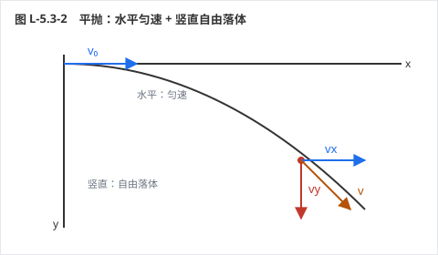
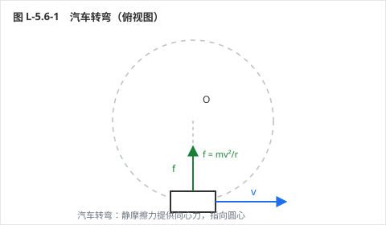
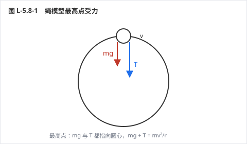

# 力学 · 单元四：曲线运动

> **状态**：【样章待验收　v5 版】
> **覆盖**：A-5.1 ～ A-5.9，共 9 考点 / 27 道例题 / 3 张示意图
> **单元定位**：第一次处理"二维运动"。核心只有一条：**把曲线运动拆成两个直线运动**——平抛拆成水平匀速 + 竖直自由落体，圆周运动拆成"切向"和"指向圆心"。

## 🗺️ 关卡地图

| 关 | 考点 | 难度 | 星级 |
|---|---|---|---|
| 1 | 曲线运动的条件与速度方向 | ★ | ☆☆☆ |
| 2 | 运动的合成与分解 | ★★★ | ☆☆☆ |
| 3 | 平抛运动 | ★★★ | ☆☆☆ |
| 4 | 描述圆周运动的物理量 | ★★ | ☆☆☆ |
| 5 | 向心加速度 | ★★ | ☆☆☆ |
| 6 | 向心力的来源 | ★★★ | ☆☆☆ |
| 7 | 水平面内的圆周运动 | ★★★★ | ☆☆☆ |
| 8 | 竖直面内的圆周运动 | ★★★★ | ☆☆☆ |
| 9 | 离心运动 | ★★ | ☆☆☆ |

---

## A-5.1 曲线运动的条件与速度方向

*力学 › 必修二 第5章 曲线运动 ｜ Ⅰ · 考频低 ｜ 前置 A-4.2 ｜ 关联 A-5.2*

**⚡ 先猜**：做曲线运动的物体，速度方向指向轨迹的哪一边？

### 30 秒概述

速度方向永远**沿轨迹的切线**，不是指向圆心、也不是指向终点。而物体之所以"拐弯"，是因为合力与速度**不在一条直线上**——合力把速度"掰"向自己那一侧，所以轨迹总是向合力方向弯曲。

### 30 秒自评

1. 曲线运动一定是变速运动。
2. 做曲线运动的物体，加速度可以为零。
3. 曲线运动中，速度方向沿轨迹的切线方向。

> **答案**：1. ✓（速度方向一直在变）　2. ✗（有加速度才能拐弯）　3. ✓

### 🔑 原理与公式

- 速度方向：**沿轨迹切线**，指向运动方向
- 做曲线运动的条件：**合力（加速度）与速度不共线**
- 轨迹弯曲方向：**总指向合力一侧**（凹侧）
- 合力与速度夹角：锐角 ⇒ 加速；钝角 ⇒ 减速

**适用条件**：合力恒定时做匀变速曲线运动（如平抛）；合力变化时做变加速曲线运动（如圆周运动）。

**易错边界**
1. 认为速度方向指向圆心（那是向心加速度的方向）
2. 认为曲线运动加速度一定变化（平抛的 a = g 恒定）
3. 把轨迹画向合力的一侧画反（应向合力方向弯）

### 例题 1 · L1 基础

砂轮高速旋转打磨刀具，火星沿什么方向飞出？雨天转动雨伞，水滴沿什么方向飞出？

**解析**：火星和水滴脱离砂轮/伞面后不受向心力，由于**惯性**沿脱离瞬间的**切线方向**飞出。

**💥 陷阱**：认为"沿半径向外飞"。半径方向是向心力的反方向，不是速度方向。

**变式**：绳系小球在水平面内转圈，绳突然断了，小球沿什么方向运动？（切线方向，之后做匀速直线运动）

### 例题 2 · L2 常考

判断：(1) 曲线运动一定是变速运动；(2) 匀变速曲线运动不存在；(3) 曲线运动的合力一定变化。

**解析**：
(1) ✓ 速度方向不断改变
(2) ✗ 平抛就是匀变速曲线运动（a = g 恒定）
(3) ✗ 平抛的合力恒为重力

**💥 陷阱**：把"曲线"和"变加速"划等号。判断是否匀变速，只看**合力是否恒定**。

**变式**：匀速圆周运动是匀变速运动吗？（不是，加速度方向不断变化）

### 例题 3 · L3 综合

物体沿曲线从 A 运动到 B，轨迹如图弯曲。判断：合力可能指向轨迹的哪一侧？若在某点速度与合力夹角为钝角，物体做什么运动？

**解析**：
1. 轨迹向合力方向弯曲 ⇒ 合力指向轨迹的**凹侧**（内侧）
2. 速度与合力夹角为钝角 ⇒ 合力有阻碍运动的分量 ⇒ **减速**
3. 夹角为锐角 ⇒ 加速；夹角 90° ⇒ 速率不变（匀速圆周运动）

**💥 陷阱**：认为"合力指向轨迹外侧"。弯道上的车之所以能拐过去，正是因为合力（摩擦力）指向弯道内侧。

**变式**：若合力突然消失，物体如何运动？（沿此时速度方向做匀速直线运动）

### ⏱️ 限时挑战（90 秒）

① 曲线运动的速度方向？② 判断：曲线运动的加速度一定不为零。

> 答案：① 沿轨迹切线　② ✓

### ✅ 接下来做什么

你刚才做了 **3 道自评题**，先数一下对了几道：

- **3 道全对** → 这个考点你已经会了。直接做「例题 3」+ 它的变式；两题都对，就跳到下一个考点。
- **对 2 道** → 先读上面的「易错边界」，再做「例题 2」和「例题 3 的变式」。
- **对 0–1 道** → 从「原理与公式」开始，按顺序把例题 1、2、3 做完。

> **按年级的过关线**：高一做到例题 1 就行｜高二做到例题 2｜高三要例题 3 和变式都对。

---

## A-5.2 运动的合成与分解

*力学 › 必修二 第5章 曲线运动 ｜ Ⅱ · 考频**高** ｜ 前置 A-5.1 ｜ 关联 A-5.3　★*

**⚡ 先猜**：小船船头始终垂直河岸，能到达正对岸吗？

### 30 秒概述

合运动与分运动**等时**、**独立**、**等效**。小船渡河有两类问题：要**时间最短**，船头垂直河岸；要**到达正对岸**，船头必须斜向上游，且船速要大于水速。

### 30 秒自评

1. 合运动与分运动所用的时间相同。
2. 船头垂直河岸时，渡河时间最短。
3. 船头垂直河岸时，小船能到达正对岸。

> **答案**：1. ✓　2. ✓　3. ✗（会被水冲向下游）

### 🔑 原理与公式

- 合运动与分运动：**等时性、独立性、等效性**
- **最短时间**：船头垂直河岸，**t = d/v船**
- **最短位移/正对岸**：船头斜向上游，**v合 = √(v船² − v水²)**（需 v船 > v水）
- 绳船模型：**v船 = v绳/cosθ**（θ 为绳与船运动方向的夹角）

**适用条件**：两个分运动互不影响；绳子不可伸长（绳船模型）。

**易错边界**
1. 把船头方向当成合速度方向
2. 求"到达正对岸"时仍用船头垂直
3. 绳船模型中把 v船 与 v绳 直接相等

### 例题 1 · L1 基础

河宽 60 m，船速 4 m/s（静水），水速 3 m/s。船头始终垂直河岸，求渡河时间和实际位移。

**解析**：
1. 垂直河岸方向：t = d/v船 = 60/4 = **15 s**
2. 沿河岸方向：被冲下 x = 3 × 15 = 45 m
3. 合速度 v = √(4² + 3²) = 5 m/s ⇒ 实际位移 = 5 × 15 = **75 m**

**💥 陷阱**：认为位移就是 60 m。船被水冲走 45 m，实际走的是斜线 75 m。

**变式**：若水速增大到 4 m/s，渡河时间变吗？（不变，仍 15 s——水速不影响垂直分量）

### 例题 2 · L2 常考

承上题（河宽 60 m、船速 4 m/s、水速 3 m/s）。要使小船到达正对岸，船头应指向哪里？用多长时间？

**解析**：
1. 要合速度垂直河岸，垂直分量必须是 √(4² − 3²) = √7 ≈ **2.65 m/s**
2. 船头需斜向上游，与河岸夹角满足 cosθ = 3/4 ⇒ θ ≈ **41.4°**
3. t = 60/2.65 ≈ **22.7 s**（比最短时间长）

**💥 陷阱**：直接答 t = 60/4 = 15 s 且能到正对岸——两者不可兼得。

**变式**：若水速 5 m/s > 船速 4 m/s，还能到正对岸吗？（不能，最短位移为斜线，永远被冲向下游）

### 例题 3 · L3 综合

人通过定滑轮拉船靠岸，绳子以 0.5 m/s 匀速收缩。当绳与水平方向成 37° 时，船的速度多大？

**解析**：
1. 船的实际速度沿水面（合速度），绳的收缩速度是船速在**绳方向的分量**
2. v绳 = v船 cos37° ⇒ v船 = v绳/cos37° = 0.5/0.8 = **0.625 m/s**
3. 注意：船越靠近岸，θ 越大，cosθ 越小，v船 越大（加速靠岸）

**💥 陷阱**：答 0.5 m/s，把绳速当船速。船沿水面走，绳只是它的一个分量。

**变式**：当绳与水面的夹角变为 60° 时，船速多大？（0.5/0.5 = 1 m/s）

### ⏱️ 限时挑战（90 秒）

① 最短渡河时间的条件？② 判断：水速越大，渡河时间越长。

> 答案：① 船头垂直河岸　② ✗（水速不影响渡河时间）

### ✅ 接下来做什么

你刚才做了 **3 道自评题**，先数一下对了几道：

- **3 道全对** → 这个考点你已经会了。直接做「例题 3」+ 它的变式；两题都对，就跳到下一个考点。
- **对 2 道** → 先读上面的「易错边界」，再做「例题 2」和「例题 3 的变式」。
- **对 0–1 道** → 从「原理与公式」开始，按顺序把例题 1、2、3 做完。

> **按年级的过关线**：高一做到例题 1 就行｜高二做到例题 2｜高三要例题 3 和变式都对。

---

## A-5.3 平抛运动

*力学 › 必修二 第5章 曲线运动 ｜ Ⅱ · 考频**高** ｜ 前置 A-5.2、A-2.5 ｜ 关联 A-5.4　★*

**⚡ 先猜**：平抛运动中，水平方向的速度会越来越小吗？

### 30 秒概述

平抛 = **水平匀速** + **竖直自由落体**，两个方向互不干扰。所以"下落时间只由高度决定，与初速度无关"——这句话能秒掉一半的平抛题。

### 30 秒自评

1. 平抛运动是匀变速曲线运动。
2. 平抛运动中，水平方向做匀速直线运动。
3. 平抛的落地时间只与下落高度有关。

> **答案**：1. ✓（a = g 恒定）　2. ✓　3. ✓

### 🔑 原理与公式

- 水平：**x = v₀t**（匀速）
- 竖直：**y = ½gt²**、**v_y = gt**（自由落体）
- 合速度：**v = √(v₀² + v_y²)**，与水平方向夹角 tanθ = v_y/v₀
- 落地时间：**t = √(2h/g)**，与 v₀ 无关

**适用条件**：初速度水平、只受重力（忽略空气阻力）。

**易错边界**
1. 认为初速度越大落地越晚（时间只由高度定）
2. 求合速度时忘记矢量合成
3. 平抛落在斜面上时，误把位移角当成速度角

### 例题 1 · L1 基础

小球以 20 m/s 水平抛出，抛出点高 20 m（g = 10）。求落地时间、水平射程、落地速度。

**解析**：
1. t = √(2×20/10) = **2 s**
2. x = 20 × 2 = **40 m**
3. v_y = 10 × 2 = 20 m/s ⇒ v = √(400 + 400) ≈ **28.3 m/s**，与水平成 45°

**💥 陷阱**：用 v = v₀ + gt = 40 m/s。水平方向和竖直方向不能直接相加。

**变式**：若初速度改为 40 m/s，落地时间变吗？（不变，仍 2 s；射程变 80 m）

### 例题 2 · L2 常考

小球以 10 m/s 水平抛出，落地点比抛出点低 45 m（g = 10）。求飞行时间、水平射程和落地速度大小。

**解析**：
1. t = √(2×45/10) = **3 s**
2. x = 10 × 3 = **30 m**
3. v_y = 30 m/s ⇒ v = √(100 + 900) ≈ **31.6 m/s**

**💥 陷阱**：用 45 = v₀t 求时间。竖直方向才用 45 m。

**变式**：落地速度与水平方向的夹角？（tanθ = 30/10 = 3，θ ≈ 71.6°）

### 例题 3 · L3 综合

小球从倾角 37° 的斜面顶端水平抛出，恰好落在斜面底端，初速度 10 m/s（g = 10，sin37° = 0.6）。
(1) 求飞行时间；
(2) 求水平射程和下落高度；
(3) 求落地时速度方向与水平方向的夹角。

**解析**：
1. 落在斜面上：位移方向沿斜面 ⇒ tan37° = y/x = (½gt²)/(v₀t) = gt/(2v₀)
   0.75 = 10t/20 ⇒ t = **1.5 s**
2. x = 10 × 1.5 = **15 m**；y = ½ × 10 × 2.25 = **11.25 m**
3. v_y = 15 m/s ⇒ tanα = 15/10 = 1.5 ⇒ α ≈ **56.3°**
   注意 tanα = 2tan37° = 1.5（速度偏角正切是位移偏角正切的 2 倍）

**💥 陷阱**：把"位移偏角 37°"当成"速度偏角 37°"。位移偏角的正切是速度偏角正切的一半。

**变式**：若初速度增大，落点会怎样变化？（水平位移和竖直位移同时增大，仍落在斜面延长线上，t 与 v₀ 成正比）

### ⏱️ 限时挑战（90 秒）

① 平抛落地时间由什么决定？② 从相同高度、不同初速度平抛，谁先落地？

> 答案：① 高度　② 同时落地

### ✅ 接下来做什么

你刚才做了 **3 道自评题**，先数一下对了几道：

- **3 道全对** → 这个考点你已经会了。直接做「例题 3」+ 它的变式；两题都对，就跳到下一个考点。
- **对 2 道** → 先读上面的「易错边界」，再做「例题 2」和「例题 3 的变式」。
- **对 0–1 道** → 从「原理与公式」开始，按顺序把例题 1、2、3 做完。

> **按年级的过关线**：高一做到例题 1 就行｜高二做到例题 2｜高三要例题 3 和变式都对。

---

## A-5.4 描述圆周运动的物理量

*力学 › 必修二 第5章 曲线运动 ｜ Ⅱ · 考频中 ｜ 前置 A-5.1 ｜ 关联 A-5.5*

**⚡ 先猜**：线速度大的点，角速度一定大吗？

### 30 秒概述

描述圆周运动有四个量：线速度 v、角速度 ω、周期 T、转速 n，它们靠 **v = ωr** 串起来。判断传动问题时只需两句：**同轴转动 ω 相同，皮带传动边缘 v 相同**。

### 30 秒自评

1. v = ωr 对任何圆周运动都成立。
2. 同轴转动的两个轮子上，各点的角速度相同。
3. 皮带传动时，两轮边缘的线速度大小相同。

> **答案**：1. ✓　2. ✓　3. ✓

### 🔑 原理与公式

- **v = 2πr/T**（线速度）、**ω = 2π/T**（角速度）、**v = ωr**
- 转速 n 与周期：**T = 1/n**（n 单位 r/s）
- 同轴：ω 相同 ⇒ v ∝ r；皮带/齿轮：v 相同 ⇒ ω ∝ 1/r

**适用条件**：匀速圆周运动；传动中"不打滑"是 v 相同的条件。

**易错边界**
1. 认为 v 大 ω 就大（半径可能不同）
2. 同轴模型中把 v 当成相同
3. 角度单位混用（ω 用 rad/s，不是度/秒）

### 例题 1 · L1 基础

质点做匀速圆周运动，半径 0.5 m，周期 2 s。求角速度和线速度。

**解析**：ω = 2π/T = **π ≈ 3.14 rad/s**；v = ωr = 3.14 × 0.5 ≈ **1.57 m/s**

**💥 陷阱**：把 2 s 当频率。周期是转一圈的时间，频率是每秒转几圈。

**变式**：若周期变为 1 s，线速度变为多少？（3.14 m/s，翻倍）

### 例题 2 · L2 常考

皮带传动中，主动轮半径 10 cm、从动轮半径 20 cm，皮带不打滑。求两轮边缘的线速度之比、角速度之比、向心加速度之比。

**解析**：
1. 边缘 v 相同 ⇒ v₁ : v₂ = **1 : 1**
2. ω = v/r ⇒ ω₁ : ω₂ = r₂ : r₁ = **2 : 1**
3. a = v²/r ⇒ a₁ : a₂ = r₂ : r₁ = **2 : 1**

**💥 陷阱**：认为大轮转得快。半径大的角速度反而小。

**变式**：若大轮转一圈用 0.2 s，小轮转一圈用多久？（0.1 s）

### 例题 3 · L3 综合

钟表的时针、分针、秒针都在做匀速圆周运动。
(1) 求三者的角速度之比；
(2) 若三针长度之比为 1 : 2 : 3，求针尖线速度之比。

**解析**：
1. 周期：秒针 60 s、分针 3600 s、时针 43200 s
   ω ∝ 1/T ⇒ ω时 : ω分 : ω秒 = 1/43200 : 1/3600 : 1/60 = **1 : 12 : 720**
2. v = ωr ⇒ v时 : v分 : v秒 = 1×1 : 12×2 : 720×3 = **1 : 24 : 2160**

**💥 陷阱**：按 1:1:1 算角速度，或忘记乘上半径比。

**变式**：秒针针尖的线速度约为分针的多少倍？（720 × 3/2 = 1080 倍）

### ⏱️ 限时挑战（90 秒）

① 同轴转动时哪个量相同？② 皮带传动时哪个量相同？

> 答案：① ω　② 边缘 v

### ✅ 接下来做什么

你刚才做了 **3 道自评题**，先数一下对了几道：

- **3 道全对** → 这个考点你已经会了。直接做「例题 3」+ 它的变式；两题都对，就跳到下一个考点。
- **对 2 道** → 先读上面的「易错边界」，再做「例题 2」和「例题 3 的变式」。
- **对 0–1 道** → 从「原理与公式」开始，按顺序把例题 1、2、3 做完。

> **按年级的过关线**：高一做到例题 1 就行｜高二做到例题 2｜高三要例题 3 和变式都对。

---

## A-5.5 向心加速度

*力学 › 必修二 第5章 曲线运动 ｜ Ⅱ · 考频中 ｜ 前置 A-5.4 ｜ 关联 A-5.6*

**⚡ 先猜**：匀速圆周运动是"匀速"运动吗？

### 30 秒概述

"匀速"只指**速率**不变，速度的**方向**时刻在变，所以它是变速运动，必有加速度。这个加速度始终指向圆心，只改变方向、不改变大小。

### 30 秒自评

1. 匀速圆周运动的加速度指向圆心。
2. 向心加速度的公式是 a = v²/r。
3. 匀速圆周运动的加速度为零。

> **答案**：1. ✓　2. ✓　3. ✗（速率不变但方向变）

### 🔑 原理与公式

- **a = v²/r = ω²r = 4π²r/T²**
- 方向：始终指向圆心，与速度方向**垂直**
- 作用：只改变速度方向，不改变速率

**适用条件**：圆周运动（匀速或变速都可用，但变速圆周的 a 还含切向分量）。

**易错边界**
1. 认为速率不变就没有加速度
2. a 与 v 同向（实际垂直）
3. 忘记 a 的方向时刻在变，不是恒矢量

### 例题 1 · L1 基础

质点以 4 m/s 做半径 2 m 的匀速圆周运动。求向心加速度。

**解析**：a = v²/r = 16/2 = **8 m/s²**，方向指向圆心

**💥 陷阱**：用 a = v/r = 2 计算，量纲都不对。

**变式**：若半径不变、速度加倍，加速度变为多少？（32 m/s²，4 倍）

### 例题 2 · L2 常考

质点做匀速圆周运动，半径 0.5 m，周期 2 s。求向心加速度（π 取 3.14）。

**解析**：a = 4π²r/T² = 4 × 9.86 × 0.5 / 4 ≈ **4.93 m/s²**

**💥 陷阱**：用 a = ωr 计算（漏了平方）。正确顺序：先求 ω，再用 a = ω²r。

**变式**：若周期减半，向心加速度变为多少？（4 倍，约 19.7 m/s²）

### 例题 3 · L3 综合

地球赤道上的物体随地球自转做圆周运动。地球半径 6.4×10⁶ m，自转周期约 24 h（8.64×10⁴ s）。求赤道上物体的向心加速度，并与 g 比较。

**解析**：
1. ω = 2π/T = 6.28/8.64×10⁴ ≈ **7.27×10⁻⁵ rad/s**
2. a = ω²R = (7.27×10⁻⁵)² × 6.4×10⁶ ≈ **0.034 m/s²**
3. 与 g ≈ 10 相比仅约 0.34%，所以平时可以忽略——这正是"重力≈万有引力"的依据

**💥 陷阱**：用 a = v²/R 时把 v 取成第一宇宙速度（7.9 km/s），那是近地卫星，不是地面物体。

**变式**：若地球自转加快到 1 h 一圈，赤道物体的向心加速度多大？（约 19.5 m/s²，大于 g，物体会"飞出去"）

### ⏱️ 限时挑战（90 秒）

① 向心加速度的方向？② 判断：匀速圆周运动是匀速运动。

> 答案：① 指向圆心　② ✗

### ✅ 接下来做什么

你刚才做了 **3 道自评题**，先数一下对了几道：

- **3 道全对** → 这个考点你已经会了。直接做「例题 3」+ 它的变式；两题都对，就跳到下一个考点。
- **对 2 道** → 先读上面的「易错边界」，再做「例题 2」和「例题 3 的变式」。
- **对 0–1 道** → 从「原理与公式」开始，按顺序把例题 1、2、3 做完。

> **按年级的过关线**：高一做到例题 1 就行｜高二做到例题 2｜高三要例题 3 和变式都对。

---

## A-5.6 向心力的来源

*力学 › 必修二 第5章 曲线运动 ｜ Ⅱ · 考频**高** ｜ 前置 A-5.5 ｜ 关联 A-4.2、A-5.7　★*

**⚡ 先猜**：向心力是物体"额外"受到的一种力吗？

### 30 秒概述

向心力不是新的力，是**效果力**——它由某个实际的力或合力充当：绳的拉力、静摩擦力、重力分量、万有引力、洛伦兹力。做题时先问"谁在提供向心力"，再写 F = mv²/r。

### 30 秒自评

1. 向心力是一种效果力，不是新的性质力。
2. 向心力可以由几个力的合力提供。
3. 匀速圆周运动的物体所受合力为零。

> **答案**：1. ✓　2. ✓　3. ✗（合力提供向心力，不为零）

### 🔑 原理与公式

- **F向 = mv²/r = mω²r = m·4π²r/T²**
- 常见来源：绳拉力（圆锥摆）、静摩擦（汽车转弯）、重力分量（铁路弯道）、万有引力（卫星）
- 竖直面内：最高点 mg + T = mv²/r；最低点 T − mg = mv²/r

**适用条件**：圆周运动；向心力方向始终指向圆心。

**易错边界**
1. 在受力分析图上"多画一个向心力"
2. 匀速圆周运动写"合力为零"
3. 混淆"提供向心力的力"与"向心力本身"

### 例题 1 · L1 基础

质量 0.5 kg 的小球用 1 m 长的绳系着，在光滑水平面上以 2 m/s 做匀速圆周运动。求绳的拉力。

**解析**：绳的拉力提供向心力 ⇒ T = mv²/r = 0.5 × 4 / 1 = **2 N**

**💥 陷阱**：把重力也算进向心力。水平面上重力与支持力平衡，不参与向心力。

**变式**：若速度加倍，绳的拉力变为多少？（8 N，4 倍）

### 例题 2 · L2 常考

圆锥摆：长 1 m 的绳系小球，绳与竖直方向成 37°，小球在水平面内做匀速圆周运动（g = 10）。求绳的拉力、圆周半径和线速度。

**解析**：
1. 竖直：T cos37° = mg ⇒ T = 1.25mg（若 m = 1 kg，T = 12.5 N）
2. 半径 r = L sin37° = **0.6 m**
3. 水平：T sin37° = mv²/r ⇒ v = √(gr tan37°) = √(10 × 0.6 × 0.75) = √4.5 ≈ **2.12 m/s**

**💥 陷阱**：把 r 当成绳长 1 m。半径是绳在水平面的投影。

**变式**：若绳长不变、夹角增大，线速度如何变化？（增大，v = √(gL sinθ tanθ) 随 θ 增大）

### 例题 3 · L3 综合

质量 1000 kg 的汽车在水平路面上转弯，转弯半径 50 m，轮胎与路面间动摩擦因数 0.6（g = 10）。
(1) 求汽车不打滑的最大速度；
(2) 若汽车以 20 m/s 转弯，需要多大的向心力？能否实现？
(3) 若在弯道处把路面做成倾斜的，能否提高限速？

**解析**：
1. (1) 静摩擦提供向心力：μmg ≥ mv²/r ⇒ v ≤ √(μgr) = √300 ≈ **17.3 m/s（约 62 km/h）**
2. (2) F = mv²/r = 1000 × 400/50 = **8000 N**，而最大静摩擦 = 6000 N ⇒ **无法实现，会打滑**
3. (3) 能。倾斜路面让重力与支持力的合力提供部分向心力，减小对摩擦的依赖（见 A-5.7）

**💥 陷阱**：(1) 用动摩擦算"刹车"式的减速；(2) 认为速度大只是"更费油"。

**变式**：雨天摩擦因数降为 0.3，限速变为多少？（√150 ≈ 12.2 m/s，约 44 km/h）

### ⏱️ 限时挑战（90 秒）

① 向心力是性质力还是效果力？② 匀速圆周运动的合力为零吗？

> 答案：① 效果力　② ✗

### ✅ 接下来做什么

你刚才做了 **3 道自评题**，先数一下对了几道：

- **3 道全对** → 这个考点你已经会了。直接做「例题 3」+ 它的变式；两题都对，就跳到下一个考点。
- **对 2 道** → 先读上面的「易错边界」，再做「例题 2」和「例题 3 的变式」。
- **对 0–1 道** → 从「原理与公式」开始，按顺序把例题 1、2、3 做完。

> **按年级的过关线**：高一做到例题 1 就行｜高二做到例题 2｜高三要例题 3 和变式都对。

---

## A-5.7 水平面内的圆周运动

*力学 › 必修二 第5章 曲线运动 ｜ Ⅱ · 考频**高** ｜ 前置 A-5.6 ｜ 关联 A-5.8　★*

**⚡ 先猜**：火车转弯时，为什么外轨要比内轨高？

### 30 秒概述

水平面内的圆周运动，向心力来自**静摩擦**或**重力与支持力的合力**。汽车转弯靠轮胎摩擦，铁路弯道靠"外高内低"让重力分量帮忙——这样既不磨损外轨，又能提高限速。

### 30 秒自评

1. 火车转弯完全依靠外轨对车轮的挤压。
2. 铁路弯道的设计速度满足 tanθ = v²/(gr)。
3. 汽车转弯速度过大时，会向外侧滑。

> **答案**：1. ✗（理想情况靠重力和支持力的合力）　2. ✓　3. ✓

### 🔑 原理与公式

- 水平路面转弯：**μmg ≥ mv²/r ⇒ v_max = √(μgr)**
- 倾斜路面/铁路弯道：**mg tanθ = mv²/r ⇒ v = √(gr tanθ)**
- 圆锥摆：**T cosθ = mg，T sinθ = mv²/r**

**适用条件**：水平面内匀速圆周运动；倾斜面问题中"无侧向摩擦"是理想条件。

**易错边界**
1. 铁路弯道仍按"外轨挤压"分析
2. 倾斜面问题中把 N 写成 mg
3. 忘记 v_max 与半径的平方根关系（半径加倍，限速只增 √2 倍）

### 例题 1 · L1 基础

汽车在半径 50 m 的水平弯道上行驶，轮胎与路面动摩擦因数 0.6（g = 10）。求不打滑的最大速度。

**解析**：μmg = mv²/r ⇒ v = √(μgr) = √(0.6 × 10 × 50) = √300 ≈ **17.3 m/s**

**💥 陷阱**：用 v = √(2μgs) 的刹车公式。转弯用的是向心加速度，不是匀减速。

**变式**：若弯道半径增大到 200 m，限速变为多少？（34.6 m/s，约 125 km/h）

### 例题 2 · L2 常考

铁路弯道半径 300 m，设计时速 72 km/h（g = 10）。求外轨应比内轨高出多少（用倾角表示）？

**解析**：
1. v = 72 km/h = **20 m/s**
2. tanθ = v²/(gr) = 400/3000 ≈ **0.133**
3. θ ≈ **7.6°**（外轨略高于内轨）

**💥 陷阱**：用 sinθ = v²/(gr) 求解。重力分量是 mg sinθ 沿斜面，但向心力方向是水平的，正确的是 tanθ。

**变式**：若列车以 30 m/s 通过该弯道，会怎样？（需要的向心力变大，外轨受挤压，需减速）

### 例题 3 · L3 综合

圆锥摆：绳长 1 m，绳与竖直方向成 37°，小球质量 0.5 kg（g = 10）。
(1) 求绳的拉力和小球运动的周期；
(2) 若增大转速，绳与竖直方向的夹角如何变化？
(3) 若绳能承受的最大拉力为 10 N，求小球的最大角速度。

**解析**：
1. (1) T = mg/cos37° = 5/0.8 = **6.25 N**；r = 0.6 m
   ω = √(g/(L cos37°)) = √(10/0.8) = √12.5 ≈ **3.54 rad/s**
   T周期 = 2π/ω ≈ **1.78 s**
2. (2) 转速增大 ⇒ 需要的向心力增大 ⇒ 绳与竖直的夹角**增大**（球被"甩"得更高）
3. (3) 最大拉力 10 N：cosθ = mg/T = 5/10 = 0.5 ⇒ θ = 60°
   ω_max = √(g/(L cos60°)) = √(10/0.5) = √20 ≈ **4.47 rad/s**

**💥 陷阱**：(1) 用 ω = √(g/L) 计算，漏掉 cosθ。摆长不是旋转半径。

**变式**：当 θ 趋近 90° 时，ω 趋近多少？（趋近于无穷大，绳趋于水平）

### ⏱️ 限时挑战（90 秒）

① 水平弯道最大速度公式？② 铁路弯道的倾角满足什么关系？

> 答案：① v = √(μgr)　② tanθ = v²/(gr)

### ✅ 接下来做什么

你刚才做了 **3 道自评题**，先数一下对了几道：

- **3 道全对** → 这个考点你已经会了。直接做「例题 3」+ 它的变式；两题都对，就跳到下一个考点。
- **对 2 道** → 先读上面的「易错边界」，再做「例题 2」和「例题 3 的变式」。
- **对 0–1 道** → 从「原理与公式」开始，按顺序把例题 1、2、3 做完。

> **按年级的过关线**：高一做到例题 1 就行｜高二做到例题 2｜高三要例题 3 和变式都对。

---

## A-5.8 竖直面内的圆周运动

*力学 › 必修二 第5章 曲线运动 ｜ Ⅱ · 考频**高** ｜ 前置 A-5.6 ｜ 关联 A-6（万有引力）　★*

**⚡ 先猜**：绳系小球在竖直面内做圆周运动，最高点的速度可以为零吗？

### 30 秒概述

竖直圆分两种模型：**绳（或轨道内侧）**只能提供拉力，最高点最小速度 √(gr)；**杆（或双轨道）**能提供支持力，最高点速度可以为零。判断是哪一种，看"能不能推"。

### 30 秒自评

1. 绳模型中，小球通过最高点的最小速度是 √(gr)。
2. 杆模型中，小球通过最高点的速度可以为零。
3. 竖直圆最高点，绳的拉力方向向上。

> **答案**：1. ✓　2. ✓（杆可提供支持力）　3. ✗（绳只能拉，最高点拉力向下）

### 🔑 原理与公式

- **绳模型**最高点：**mg + T = mv²/r**，T ≥ 0 ⇒ **v_min = √(gr)**
- **杆模型**最高点：mg ± N = mv²/r，N 可向上 ⇒ **v_min = 0**
- **最低点**（两种模型相同）：**T − mg = mv²/r**

**适用条件**：竖直面内圆周运动；绳不可伸长、杆可承受拉压。

**易错边界**
1. 杆模型也套 √(gr)
2. 最高点认为绳拉力向上
3. 用机械能守恒求最高点速度时忘记"能否通过"的判断

### 例题 1 · L1 基础

长 0.5 m 的绳系小球在竖直面内做圆周运动（g = 10）。求小球通过最高点的最小速度。

**解析**：绳模型最高点 T = 0 时速度最小：mg = mv²/r ⇒ v = √(gr) = √5 ≈ **2.24 m/s**

**💥 陷阱**：答 0。绳不能推，速度为 0 时重力大于所需向心力，球会掉下来。

**变式**：若绳长变为 1.25 m，最小速度多少？（√12.5 ≈ 3.54 m/s）

### 例题 2 · L2 常考

长 0.5 m 的绳系质量 0.5 kg 的小球，在竖直面内做圆周运动。小球通过最高点时速度 3 m/s（g = 10）。求此时绳的拉力。

**解析**：最高点 mg + T = mv²/r
T = mv²/r − mg = 0.5 × 9/0.5 − 5 = 9 − 5 = **4 N**（方向向下，指向圆心）

**💥 陷阱**：写成 T − mg = mv²/r，得 T = 14 N。最高点重力和拉力**同向**。

**变式**：若最高点速度为 √5 m/s，绳的拉力多大？（0，恰好通过）

### 例题 3 · L3 综合

长 0.5 m 的轻杆一端固定小球，另一端可绕水平轴转动，小球在竖直面内做圆周运动（g = 10）。
(1) 若最高点速度为 1 m/s，求杆对球的作用力；
(2) 若最高点速度为 3 m/s，求杆对球的作用力；
(3) 求杆对球作用力为零时的速度。

**解析**：
1. (1) v = 1 m/s 时，所需向心力 mv²/r = 0.5×1/0.5 = 1 N < mg = 5 N
   ⇒ 杆提供**支持力**：mg − N = mv²/r ⇒ N = 5 − 1 = **4 N**（方向向上）
2. (2) v = 3 m/s 时，所需向心力 = 9 N > mg ⇒ 杆提供**拉力**：mg + T = mv²/r ⇒ T = **4 N**（方向向下）
3. (3) N = 0 ⇒ mg = mv²/r ⇒ v = √(gr) ≈ **2.24 m/s**

**💥 陷阱**：第 (1) 问直接套 mg + T = mv²/r，得出 T = −4 N 却说"拉力向上"。负号意味着杆在**推**，不是拉。

**变式**：若最高点速度为 0，杆对球的作用力多大？（5 N，支持力，等于重力）

### ⏱️ 限时挑战（90 秒）

① 绳模型最高点最小速度？② 判断：杆模型最高点速度可以为零。

> 答案：① √(gr)　② ✓

### ✅ 接下来做什么

你刚才做了 **3 道自评题**，先数一下对了几道：

- **3 道全对** → 这个考点你已经会了。直接做「例题 3」+ 它的变式；两题都对，就跳到下一个考点。
- **对 2 道** → 先读上面的「易错边界」，再做「例题 2」和「例题 3 的变式」。
- **对 0–1 道** → 从「原理与公式」开始，按顺序把例题 1、2、3 做完。

> **按年级的过关线**：高一做到例题 1 就行｜高二做到例题 2｜高三要例题 3 和变式都对。

---

## A-5.9 离心运动

*力学 › 必修二 第5章 曲线运动 ｜ Ⅰ · 考频低 ｜ 前置 A-5.6 ｜ 关联 A-5.8*

**⚡ 先猜**：离心运动是因为物体受到了"离心力"吗？

### 30 秒概述

不存在"离心力"。离心运动的原因是**提供的向心力不够**——需要 mv²/r，实际只给到 F < mv²/r，物体就会越转越远。若向心力突然消失，物体沿切线做匀速直线运动。

### 30 秒自评

1. 离心运动是由于向心力不足造成的。
2. "离心力"是一种真实存在的力。
3. 洗衣机脱水利用了离心运动。

> **答案**：1. ✓　2. ✗（惯性系中不存在）　3. ✓

### 🔑 原理与公式

- 提供 F = mv²/r ⇒ 圆周运动
- 提供 F < mv²/r ⇒ **离心运动**（半径变大）
- 提供 F = 0 ⇒ 沿切线飞出
- 提供 F > mv²/r ⇒ 向心运动（半径变小）

**适用条件**：用惯性参考系分析；"离心力"只在转动参考系中作为惯性力出现，中学不引入。

**易错边界**
1. 认为离心运动是"被甩出去"（其实是"没拉住"）
2. 认为速度越大越容易离心（真正决定的是 F 与 mv²/r 的大小关系）
3. 把"沿切线飞出"说成"沿半径飞出"

### 例题 1 · L1 基础

下列现象哪些属于离心运动：① 洗衣机脱水；② 汽车转弯时乘客向外倾；③ 卫星绕地球做圆周运动；④ 绳断后小球飞出。

**解析**：① ✓（水与衣服间附着力不足）② ✓（乘客惯性，身体保持直线运动）③ ✗（正常圆周运动）④ ✓（向心力消失，沿切线飞出）

**💥 陷阱**：把③也算进去。匀速圆周运动是"提供的力恰好等于需要的力"，不是离心。

**变式**：离心运动一定是曲线运动吗？（不一定，向心力完全消失时是直线）

### 例题 2 · L2 常考

绳系小球在光滑水平面上做匀速圆周运动，绳突然断裂。小球此后如何运动？若绳是逐渐松弛的（转速减小），又如何？

**解析**：
1. 绳断 ⇒ 向心力消失 ⇒ 沿断裂瞬间的**切线方向**做匀速直线运动
2. 转速减小 ⇒ 需要的向心力减小 ⇒ 提供的拉力相对"过大" ⇒ 小球做**向心运动**（半径变小），不是离心

**💥 陷阱**：认为"转速减小会甩出去"。需要向心力变小，反而会被拉近。

**变式**：若转速增大（绳未断），小球会怎样？（需要的向心力变大，绳拉力增大；若超出绳的承受力则断裂飞出）

### 例题 3 · L3 综合

汽车在水平弯道上转弯，半径 50 m，轮胎与路面动摩擦因数 0.6（g = 10）。
(1) 求安全通过的最大速度；
(2) 若以 25 m/s 通过，汽车会怎样运动？
(3) 为什么雨天要减速慢行？

**解析**：
1. (1) v_max = √(μgr) = √300 ≈ **17.3 m/s**
2. (2) 25 m/s 时需要的向心力 = mv²/r，超过最大静摩擦 ⇒ 向心力不足 ⇒ 汽车做**离心运动**，向外侧滑出
3. (3) 雨天 μ 减小（约 0.3）⇒ v_max = √150 ≈ 12.2 m/s，限速必须降低

**💥 陷阱**：(2) 认为"速度大只是转弯半径变大"。实际是轮胎抓不住地面，车会侧滑甚至甩尾。

**变式**：若弯道改为倾斜路面，能否提高通过速度？（能，重力分量参与提供向心力）

### ⏱️ 限时挑战（90 秒）

① 离心运动的本质？② 判断：存在"离心力"这种真实的力。

> 答案：① 向心力不足　② ✗

### ✅ 接下来做什么

你刚才做了 **3 道自评题**，先数一下对了几道：

- **3 道全对** → 这个考点你已经会了。直接做「例题 3」+ 它的变式；两题都对，就跳到下一个考点。
- **对 2 道** → 先读上面的「易错边界」，再做「例题 2」和「例题 3 的变式」。
- **对 0–1 道** → 从「原理与公式」开始，按顺序把例题 1、2、3 做完。

> **按年级的过关线**：高一做到例题 1 就行｜高二做到例题 2｜高三要例题 3 和变式都对。

---

## 本章公式总表

| # | 公式 | 含义 | 条件 |
|---|---|---|---|
| 1 | x = v₀t，y = ½gt² | 平抛分解 | 初速水平、只受重力 |
| 2 | t = √(2h/g) | 平抛时间 | 与 v₀ 无关 |
| 3 | v = √(v₀² + (gt)²) | 平抛合速度 | 矢量合成 |
| 4 | v = ωr = 2πr/T | 线速度 | 圆周运动 |
| 5 | ω = 2π/T | 角速度 | 圆周运动 |
| 6 | a = v²/r = ω²r = 4π²r/T² | 向心加速度 | 指向圆心 |
| 7 | F = mv²/r = mω²r | 向心力 | 效果力 |
| 8 | v = √(μgr) | 水平弯道限速 | 静摩擦提供向心力 |
| 9 | tanθ = v²/(gr) | 铁路弯道倾角 | 无侧向摩擦 |
| 10 | v_min = √(gr) | 绳模型最高点 | 绳只能拉 |
| 11 | T − mg = mv²/r | 最低点 | 两种模型相同 |
| 12 | v船 = v绳/cosθ | 绳船模型 | 绳不可伸长 |

## 本章易错清单

| # | 错误 | 正确 |
|---|---|---|
| 1 | 速度方向指向圆心 | 沿轨迹切线 |
| 2 | 曲线运动加速度一定变 | 平抛的 a = g 恒定 |
| 3 | 船头垂直河岸能到正对岸 | 会被冲向下游 |
| 4 | 水速越大渡河越慢 | 渡河时间与 v水 无关 |
| 5 | 初速度越大平抛越晚落地 | 时间只由高度定 |
| 6 | 斜面上平抛位移角 = 速度角 | tanα = 2tanθ |
| 7 | v 大 ω 就大 | v = ωr，看半径 |
| 8 | 匀速圆周运动合力为零 | 合力提供向心力 |
| 9 | 向心力是性质力 | 是效果力 |
| 10 | 杆模型也套 √(gr) | 杆可推，v 可为 0 |
| 11 | 最高点绳拉力向上 | 向下，指向圆心 |
| 12 | 离心运动是"离心力"造成 | 向心力不足 |

## 本章关系边

| 起点 | 终点 | 类型 |
|---|---|---|
| A-5.1 | A-5.2 | 前置 |
| A-5.2 | A-5.3 | 派生（平抛 = 两个直线运动） |
| A-5.4 | A-5.5 | 派生（v = ωr 求 a） |
| A-5.5 | A-5.6 | 派生（a → F） |
| A-5.6 | A-5.7 | 应用（水平圆周） |
| A-5.6 | A-5.8 | 应用（竖直圆周） |
| A-5.6 | A-5.9 | 延伸（离心） |
| A-5.6 | A-6 万有引力 | 综合（万有引力提供向心力） |
